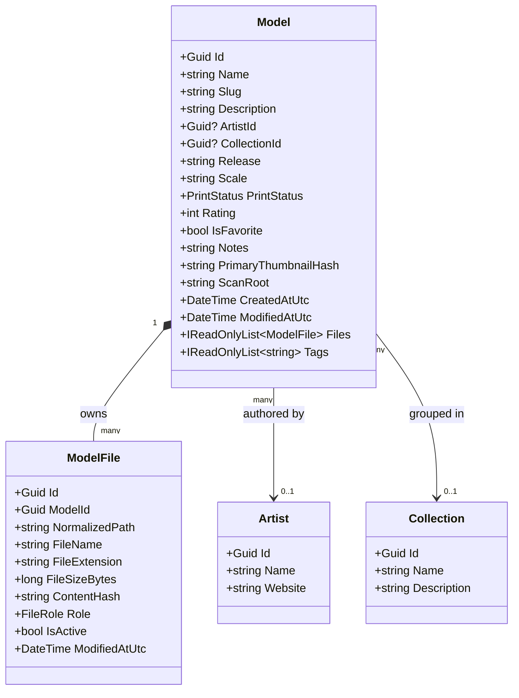

# ARCH-DPV-MODEL-ENTITY-001 — Conceptual Model Entity Architecture

**Document ID:** `ARCH-DPV-MODEL-ENTITY-001`  
**Status:** Architecture Specification & Refinement  
**Date:** 2026-11-05  
**Governing Standard:** `DEVELOPMENT_STANDARD.md`  
**Decision Alignment:** [`ADR-DPV-CATALOG-001`](decisions/ADR-DPV-CATALOG-001.md), [`ADR-DPV-METADATA-001`](decisions/ADR-DPV-METADATA-001.md), [`ADR-DPV-ORGANIZATION-001`](decisions/ADR-DPV-ORGANIZATION-001.md), [`ADR-AVALONIA-001`](decisions/ADR-AVALONIA-001-Application-Lifecycle.md), [`REA-DPV-CATALOG-001`](../research/REA-DPV-CATALOG-001-Visual-Catalog-Research.md)  
**Scope:** Definition of the Logical Model Entity, Asset Boundaries, Relational Topology, and Architectural Implications for Search, Metadata, and Catalog Presentation.  
**Constraint:** Design and planning only. No production code changes, no database migrations, and no direct feature implementations.

---

## 1. Executive Summary

Historically, 3D Print Vault (DPV) treated an individual physical file on disk as synonymous with a catalog entry ($1\text{ file} = 1\text{ catalog item}$). When a tabletop miniature kit containing 8 STL parts, 8 pre-supported variants, a sliced 3MF build-plate, and an instruction PDF was scanned, the catalog produced up to 17 disconnected entries.

Recent research ([`REA-DPV-CATALOG-001`](../research/REA-DPV-CATALOG-001-Visual-Catalog-Research.md)) and product decisions ([`ADR-DPV-CATALOG-001`](decisions/ADR-DPV-CATALOG-001.md), [`ADR-DPV-METADATA-001`](decisions/ADR-DPV-METADATA-001.md)) demonstrate that successful media catalogs (Calibre, Plex, Eagle, Lightroom) never treat raw files as first-class catalog citizens. **Users do not search for, organize, or evaluate loose files; users search for, evaluate, and print MODELS.**

This document formally establishes the **Model Entity** as the atomic unit of the DPV catalog. It decouples the **Logical Asset** (the cohesive creative work) from the **Physical Assets** (the underlying geometry, slicing, preview, and documentation files), establishing a scalable foundation for visual browsing, faceted filtering, and non-destructive library organization.

---

## 2. Why Model Is The Catalog Unit

In 3D printing workflows, creative assets are produced, distributed, and consumed as functional units rather than isolated geometry files:

```
┌────────────────────────────────────────────────────────────────────────────────────────┐
│ The Real-World 3D Printing Asset (e.g. Patreon / Kickstarter / Store Download)         │
├────────────────────────────────────────────────────────────────────────────────────────┤
│ Folder: /ArtisanGuild/Dragons/RedDragon/                                               │
│   ├── red_dragon_body.stl               <- Geometry Part (Unsupported)                 │
│   ├── red_dragon_wings.stl              <- Geometry Part (Unsupported)                 │
│   ├── red_dragon_body_supported.stl     <- Slicing / Print Variant (Pre-supported)     │
│   ├── red_dragon_wings_supported.stl    <- Slicing / Print Variant (Pre-supported)     │
│   ├── red_dragon_full_plate.3mf         <- Slicer Build Plate Project                  │
│   ├── red_dragon_render.png             <- Official Hero Render Preview                │
│   ├── assembly_guide.pdf                <- Documentation / Instructions                │
│   └── license.txt                       <- Legal Terms                                 │
└────────────────────────────────────────────────────────────────────────────────────────┘
```

### The Problem With File-Centric Catalogs:
1. **Catalog Fragmentation:** A library of 1,000 models containing multi-part kits explodes into 15,000+ unorganized, repetitive cards.
2. **Visual Noise:** Sifting through 8 nearly identical thumbnails of miniature legs, wings, and heads destroys visual discovery.
3. **Broken Mental Models:** Metadata such as Artist, Collection, Release, Scale, and Tags describes the *Dragon as a whole*, not the individual left wing. Attaching metadata to individual files causes massive duplication and update anomalies.
4. **Disjointed Slicing Workflows:** Slicers need the complete kit or pre-supported variant set. A user wants to inspect "The Red Dragon" and choose which variant to send to their slicer.

**Architectural Principle:**  
*The catalog shall display, index, filter, and organize Models. Files shall exist as managed physical assets owned by a Model.*

---

## 3. Logical Asset Definition

A **Logical Asset** is an abstract, cohesive entity representing a single complete 3D printable subject, character, prop, terrain feature, or functional tool.

### Responsibilities of the Logical Asset:
- Serves as the primary record in catalog navigation, search queries, and presentation views.
- Acts as the single attachment point for descriptive metadata (Name, Artist, Collection, Release, Tags, Description, Scale, Notes).
- Maintains user-specific state (Favorite status, Print status, Rating, Personal notes).
- Governs the selection of primary visual identity (Hero Thumbnail and Preview Render).
- Owns one or more physical file assets and coordinates their roles (raw geometry, supported variant, assembly part, documentation).

---

## 4. Physical Asset Definition

A **Physical Asset** is a concrete file residing on local or network storage that provides data, geometry, instructions, or visuals for a Logical Asset.

### Characteristics of a Physical Asset:
- Belongs strictly to exactly one Model within a given scan root.
- Possesses immutable filesystem properties: Absolute Path, File Name, Extension, Byte Size, Modified Timestamp, and SHA-256 Content Hash.
- Serves a specific functional **File Role**:
  - `PrimaryGeometry`: Main unsupported STL/OBJ mesh.
  - `SupportedVariant`: Pre-supported STL ready for resin printing.
  - `SlicedPlate`: Pre-sliced or configured 3MF/Chitubox/Lychee project.
  - `Part`: Component of a multi-part assembly (e.g., Head, Torso, Base).
  - `VisualPreview`: Artist render, photo of physical print, or turntable PNG/JPG.
  - `Documentation`: Assembly guide, stat-block, or licensing text.
- Never directly participates in top-level catalog search results; its contents are indexed upward into the parent Model.

---

## 5. Model Entity Schema



### Attribute Categorization

| Attribute | Type | Category | Description & Justification |
| :--- | :--- | :--- | :--- |
| **ModelId** | `Guid` | **Mandatory** | Unique identity across the entire catalog and database. |
| **Name** | `string` | **Mandatory** | User-facing display title (e.g., "Ancient Red Dragon"). |
| **ScanRoot** | `string` | **Mandatory** | The root library folder under which the model was discovered. |
| **CreatedAtUtc** | `DateTime` | **Mandatory** | Timestamp when the model was first indexed into DPV. |
| **ModifiedAtUtc** | `DateTime` | **Mandatory** | Timestamp of the most recent metadata or file change. |
| **ArtistId** | `Guid?` | **Optional** | Relational link to the creator or studio (`Artists` table). |
| **CollectionId** | `Guid?` | **Optional** | Relational link to campaign, bundle, or theme (`Collections` table). |
| **Release** | `string?` | **Optional** | Temporal release grouping (e.g., "January 2026", "Kickstarter Wave 1"). |
| **Description** | `string?` | **Optional** | Free-text narrative or background lore. |
| **Scale** | `string?` | **Optional** | Standard tabletop scale (e.g., "28mm", "32mm", "75mm", "1:10"). |
| **Tags** | `List<string>` | **Optional** | Flexible multi-value descriptors (`miniature`, `dragon`, `articulated`). |
| **PrimaryThumbnailHash**| `string?` | **Optional** | SHA-256 hash pointing to the primary preview in `ThumbnailCache`. |
| **PrintStatus** | `Enum` | **Optional** | State machine: `Unprinted`, `Queued`, `Printed`, `Failed`. |
| **Rating** | `int` | **Optional** | User rating (0 to 5 stars). |
| **IsFavorite** | `bool` | **Optional** | Quick-access bookmark flag. |
| **Notes** | `string?` | **Optional** | User slicing tips, printer settings, or paint notes. |
| **Slug** | `string` | **Future** | URL/Filename safe representation for Phase 4 Vault reorganization. |
| **ExternalId** | `string?` | **Future** | MyMiniFactory / Thingiverse / Printables remote object identifier. |
| **FilePath** | `string` | **Deprecated** | Direct file paths on `Model` are deprecated; paths belong strictly to `ModelFile`. |

---

## 6. Model Relationships & Entity Relationship Diagram (ERD)

```text
┌──────────────┐          1:N           ┌────────────────────────┐
│   Artists    │───────────────────────<│         Models         │
└──────────────┘                        │                        │
                                        │  - Id (PK)             │
┌──────────────┐          1:N           │  - Name                │
│ Collections  │───────────────────────<│  - ArtistId (FK)        │
└──────────────┘                        │  - CollectionId (FK)   │
                                        │  - PrimaryThumbnailHash│
┌──────────────┐          N:M           │  - PrintStatus         │
│     Tags     │>──────────────────────<│  - IsFavorite          │
└──────────────┘                        └────────────────────────┘
                                            │ 1
                                            │
                                            │ 1:N (Owns)
                                            ▼
                                        ┌────────────────────────┐
                                        │       ModelFiles       │
                                        │                        │
                                        │  - Id (PK)             │
                                        │  - ModelId (FK)        │
                                        │  - NormalizedPath      │
                                        │  - ContentHash (FK)    │
                                        │  - FileRole            │
                                        │  - IsActive            │
                                        └────────────────────────┘
                                            │ N
                                            │
                                            │ N:1
                                            ▼
                                        ┌────────────────────────┐
                                        │     ThumbnailCache     │
                                        │                        │
                                        │  - ContentHash (PK)    │
                                        │  - CacheStatus         │
                                        │  - GeneratedAt         │
                                        └────────────────────────┘
```

### Relationship Rules:
1. **Model to ModelFiles ($1 : N$):** A Model owns one or more physical files. Deleting or inactivating a Model cascades to its files in the catalog.
2. **Model to Artist ($N : 1$, Optional):** Multiple Models belong to one Artist. If an Artist is renamed, all child Models inherit the change instantly.
3. **Model to Collection ($N : 1$, Optional):** Models are grouped into thematic collections or releases.
4. **Model to Tags ($N : M$):** Many-to-many relationship managed via `ModelTags` junction table.
5. **ModelFile to ThumbnailCache ($N : 1$ via ContentHash):** Files reference preview images keyed by content hash. If five files share the same hash, only one thumbnail record exists.
6. **Model to Metadata Sidecar ($1 : 1$):** When sidecars are enabled, one `.dpv.json` file is maintained adjacent to the model's primary directory, representing the serialized `Model` entity.

---

## 7. Search Implications

Search must operate at the **Model level**, returning discrete model cards rather than loose files.

### Unified Search Indexing:
The SQLite FTS5 index (`Models_Fts`) shall index the aggregated text surface of the Model:
$$\text{FTS Surface} = \text{Model Name} + \text{Artist Name} + \text{Collection Name} + \text{Tags} + \text{Constituent File Names}$$

### Search Query Behavior:
- **Query:** `dragon supported`
  - Matches models where `Name` contains "dragon" AND one of its constituent `ModelFiles` has `Role == SupportedVariant` or contains "supported" in its filename.
- **Result Presentation:** Returns **1 Model Card** ("Ancient Red Dragon") with a badge: `[2 Supported Files]`, rather than returning two separate unlinked file rows.
- **Faceted Filtering:** Filtering by `Artist: LootStudios` and `Tag: Monster` evaluates model-level relations, producing zero duplicate cards.

---

## 8. Metadata Implications

Metadata attribution moves from low-level files to high-level Models:

1. **Inheritance to Files:** When a user tags a Model with `Tabletop, Fantasy, 32mm`, all constituent files inherit these tags contextually.
2. **Batch Tagging:** In multi-select grid mode, selecting 20 models applies tags across 20 `Model` records in a single transactional batch, immediately categorizing all underlying 150+ STL files.
3. **Automatic Folder Harvesting:** As specified in `ADR-DPV-METADATA-001` (Tier 2), the scanner inspects folder boundaries. Files within `D:\Vault\ArtisanGuild\Dragons\RedDragon\` are coalesced into a single Model named `RedDragon`, automatically assigned to Artist `ArtisanGuild` and Collection `Dragons`.

---

## 9. Catalog Presentation Implications

The Model Entity transforms all three presentation view modes defined in [`REA-DPV-CATALOG-001`](../research/REA-DPV-CATALOG-001-Visual-Catalog-Research.md):

### A. Grid View
- **Card Identity:** Represents **1 Model**.
- **Hero Preview:** Displays the model's primary thumbnail or artist render.
- **Card Badges:** 
  - File count pill: `4 STLs`
  - Format badges: `3MF`, `Supported`
  - Print status icon: `✔ Printed`
- **Hover Action:** Quick preview or direct click to open details.

### B. List / Compact View
- High-density rows displaying Model Name, Artist, Collection, and file count pill.
- Arrow expansion or side inspector reveals constituent files without navigating away.

### C. Details / Table View
- Each row represents a Model, with sortable columns: `Model Name`, `Artist`, `Collection`, `Total Files`, `Total Size`, `Date Added`.

### D. Inspector Panel
- Top: 3D / 2D Hero Preview.
- Middle: Model Name, Artist picker, Collection picker, Tag input, Print Status selector, Notes.
- Bottom (**Constituent File Tree**): Virtualized list of all files belonging to the model, displaying filename, role badge (`Supported`, `Part`, `Plate`), byte size, and an `[Open File]` action.

---

## 10. Future Expansion Considerations

1. **Kit & Assembly Hierarchies:** Future multi-part assemblies can define parent/child part dependencies within a Model (e.g., `Torso` requires `LeftArm_VariantA`).
2. **Slicer Integration:** When sending a model to PrusaSlicer, Bambu Studio, or OrcaSlicer, DPV can pass the complete set of constituent parts as an assembled multi-material plate.
3. **Smart Duplicate Handling:** Exact duplicate detection operates on file content hashes, but duplicate resolution merges metadata at the Model level, preserving user tags even if physical files are deduplicated.

---

## 11. Architectural Risks & Mitigations

| Risk | Description | Mitigation |
| :--- | :--- | :--- |
| **Grouping Ambiguity** | Determining which files belong to which Model in messy, unorganized folders (e.g., a flat directory with 500 loose files). | **Deterministic Heuristics:** Files sharing a common subfolder or common filename prefix stem are grouped. Standalone files in flat roots default to single-file models until grouped. |
| **Rescan Desynchronization** | If a user adds or removes one STL from a model folder, the parent Model must update without losing tags or ratings. | Re-indexing identifies modified roots, reconciles the `ModelFiles` collection via `ContentHash`, and preserves the parent `Model` entity identity. |
| **Database Migration Complexity** | Moving from strict 1:1 file records to true 1:N Model-to-Files relationships. | The SQLite schema already has separate `Models` and `ModelFiles` tables. Migrating requires grouping heuristics in the repository layer rather than breaking relational tables. |

---

## 12. Architectural Recommendations

1. **Adopt Model as the Core Aggregate:** Update all future Domain contracts and UI ViewModels so that catalog queries return collections of `ModelDto` rather than flat file lists.
2. **Implement Folder-Based Kit Grouping:** During library scanning, group all STLs within a discrete leaf directory into a single `Model` entity.
3. **Preserve Clean Architecture Boundaries:** `DPV.Domain` defines the `Model` entity and file roles; `DPV.Infrastructure` handles grouping heuristics and SQLite FTS5 queries; `DPV.UI` binds exclusively to Model visual cards.

---

# End Architecture Specification
