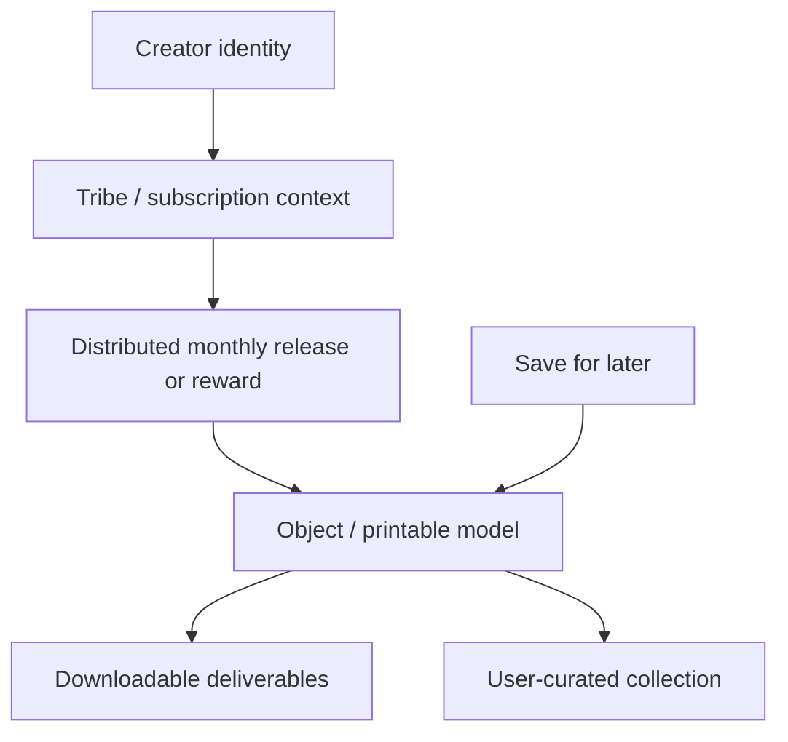

# REA-DPV-REVERSE-MMF-001: MyMiniFactory Library UX & Curation Architecture Analysis

**Document ID:** REA-DPV-REVERSE-MMF-001-B  
**Status:** Research report  
**Date:** 2026-11-06  
**Scope:** UX research, product evaluation, and design implications only. No implementation code or schema changes.  
**Target:** `myminifactory.com/library#shared`  
**Purpose:** Evaluate the mental model and curation patterns that make a digital model library feel like a collection rather than a directory of files.

> This is a separate companion report. The existing `REA-DPV-REVERSE-MMF-001.md` is preserved.

## Governing references

- [ADR-DPV-MODEL-001](../architecture/decisions/ADR-DPV-MODEL-001.md) — Model as the primary catalog entity.
- [ADR-DPV-CATALOG-001](../architecture/decisions/ADR-DPV-CATALOG-001-Visual-Catalog-Experience.md) — visual catalog direction.
- [REA-DPV-SET-BROWSING-001](REA-DPV-SET-BROWSING-001.md) — release and collection browsing research.
- [SPRINT-006 Collection Experience](../sprints/SPRINT-006-Collection-Experience.md) — delivered artwork-first cards, favorites, creator and collection browsing, and collapsed diagnostics.
- `EDR-DPV-V2-001` was named in the request but could not be located in the repository at research time. This report therefore treats “Maker Sanctuary” as a requested product framing, not as a verified governing document.

## Evidence and confidence

The requested library URL is an authenticated user surface. It could not be opened through the available public web research channel. Consequently, this report does **not** claim direct visual inspection of the current signed-in shared-library screen. Product structure and behaviors below are grounded in MMF’s publicly available creator help documentation, while layout details specific to the private view are identified as unverified. This distinction matters: describing plausible marketplace conventions as observed facts would create a false UX specification.

Official MMF help confirms that makers can find distributed Tribe files under **Library > My Tribes**; that creators distribute monthly releases to Tribe tiers; and that users can create public or private collections, add objects to them, and choose a collection cover object. It also describes a permanent **Save for later** collection. These are reliable behavioral facts, though they do not establish the precise appearance of `#shared` today. See [Tribes FAQs for Makers](https://creator.myminifactory.com/tribes-faq), [Managing and distributing Tribe releases](https://creator.myminifactory.com/how-to-manage-distribute-your-tribes-releases), and [How to set up a Collection](https://creator.myminifactory.com/how-to-set-up-a-collection).

Confidence labels used below:

- **High:** explicit in an official MMF help source or a DPV governing reference.
- **Medium:** strong interpretation of documented behaviors, but not directly observed in the target screen.
- **Low / unverified:** plausible UX hypothesis requiring a signed-in walkthrough or current screenshots.

---

## 1. Executive Summary: From file storage to collection ownership

The strongest available evidence for MMF’s library experience is its **ownership vocabulary and grouping behavior**. The maker is directed to a Library, then to meaningful contexts such as Tribes or Collections. A Tribe release is delivered as a creator-defined reward; a Collection can be named, described, made public or private, and represented by a selected cover object. “Save for later” offers an always-available holding place. The user is managing access to and curation of printable works, not manually maintaining the platform’s storage tree. **Confidence: High** for those behaviors; **Medium** for the emotional interpretation.

This shift can be summarized as:

```text
File manager: locate a path, identify a file, infer what it belongs to
Collection library: recognize a work, understand its creator/release context, choose what to do
```

The art-gallery effect is not just large images. It comes from stable identity, meaningful grouping, creator attribution, user-authored collections, and keeping delivery mechanics subordinate to the creative object. MMF’s documentation supports the creator/release and curation parts of this account. It does not verify the exact `#shared` card design, status-badge taxonomy, grid proportions, or number of clicks.

For DPV, the research aligns with the established principle **“Users discover Models. Users store Files.”** A local vault can preserve the same conceptual experience while remaining honest about its distinct constraints: files can reside on multiple disks or network locations, paths can break, artwork may be missing, and an offline catalog cannot promise cloud persistence or account-level entitlements. The DPV v2 direction should therefore foreground creator, release, model, and collection context, with asset inspection and filesystem diagnostics available on demand.

### Primary conclusion

The defensible model is not a rigid four-level tree in which every object must have one creator and one release. It is a browseable set of relationships:

```text
Creator / Tribe → Release or campaign → Model → Deliverable assets
                           ↘ User collection ↗
```

Collections are a user curation layer, not necessarily a parent in the creator’s distribution hierarchy. The same model may be discoverable through its creator/release context and appear in one or more user collections.

---

## 2. Information Architecture & Object Hierarchy

### 2.1 What the evidence supports

MMF’s public help documents two related structures:

1. **Creator distribution context:** a Tribe has tiers and monthly rewards/releases. The maker checks Library > My Tribes for distributed files; the creator chooses when a release is published and distributes it to a tier.
2. **User curation context:** a user-created Collection has a name, optional description, public/private visibility, object membership, and a selectable cover object. Save for later is a permanent collection.

Together with the marketplace’s object/model concept, these support the requested conceptual chain `Creator/Tribe → Campaign or monthly release → Object/Model → Files`. They do **not** establish that every library item belongs to a Tribe, that every release maps one-to-one to a campaign, or that user Collections are nested between releases and models.



**Confidence:** High for Tribe → distributed release and Collection → objects; Medium for the combined diagram as a useful conceptual reading; low for any claim about exact UI nesting on the target page.

### 2.2 Contrast with local directory trees

| Question | Traditional directory | MMF library concept | DPV implication |
|---|---|---|---|
| What is the thing? | Folder or file path | Object/model and its creator or release context | Keep Model as the primary catalog result. |
| How is grouping determined? | Physical containment | Creator distribution plus user-selected collections | Preserve source relationships and allow independent personal curation. |
| How is identity shown? | Names and extensions | Object, creator, release and collection context | Use artwork and human-readable identity when available. |
| Where are the bytes? | Explicit path | Abstracted behind platform delivery/download | Hide paths in ordinary browsing; expose location in diagnostics. |
| What does ownership mean? | Possession of files in a directory | Library access and curated membership | In DPV, distinguish indexed local assets from durable platform entitlements. |

An important qualification: abstraction is not deletion of storage reality. MMF mediates its hosted delivery; DPV catalogs user-owned files and must help users recover them when a drive is absent or a path changes. The user should not have to think in paths to browse, but DPV must retain path and availability details for maintenance and action.

---

## 3. Visual Cues & Card Presentation Anatomy

### 3.1 Evidence versus hypothesis

The public MMF materials emphasize creator promotional assets, clear release naming, counts of miniatures/STLs, high-quality renders or photos, and visual markers that help makers identify creator offerings at a glance. This supports the importance of authored imagery and explicit content cues. The source does **not** document the current private library’s exact card templates, image aspect ratios, badge positions, or uniform grid rules.

| Requested pattern | Research finding | Confidence |
|---|---|---|
| Edge-to-edge cinematic hero image | Prominent creator/release artwork is a documented promotional practice; exact `#shared` card treatment is unverified. | Medium / low for library UI |
| File thumbnail stamp versus artwork | The creator guide explicitly recommends high-quality renders or printed/painted images and a named release. | High for creator guidance; medium for library presentation |
| `[Pre-Supported]`, `[Chitubox]`, `[Multi-Part]`, `[Exclusive]` taxonomy | No official evidence located that these form a standardized library badge system. Treat the labels as proposed research probes, not observed MMF behavior. | Low / unverified |
| Uniform grid rhythm and aspect ratios | Not verifiable from accessible public material. | Low / unverified |

### 3.2 Card anatomy worth evaluating in a direct walkthrough

For a future authenticated observation, record each visible card’s image crop, title, creator attribution, release/collection label, ownership or download state, save/favorite control, hover behavior, and visible technical metadata. Compare a Tribe release view with an individual object view and a user Collection view. Avoid generalizing one surface to every library state.

### 3.3 DPV design evaluation

DPV already has evidence-backed precedent for artwork-first cards: Sprint 006 establishes a preview-led model card, parts count and favorite overlay, creator and collection labels, and removal of raw paths and hashes from the primary card. That is a sound local expression of the collection experience. A status cue should only appear when DPV can infer or verify it; uncertainty should not be rendered as a platform-style assurance badge. For example, a file name containing “supported” is weaker evidence than a reliable asset role or explicit user confirmation.

---

## 4. User Journey & Navigation Flow

### 4.1 Evidence-backed journey

The help materials provide two documented journeys:

**Tribe reward discovery:** a subscribed maker goes to Library > My Tribes to find distributed files. Availability depends on active subscription and creator publication status; the platform notes that creators control when releases are made available.

**Collection curation:** a user navigates to Library > Collections, creates a collection with a required name and optional description and visibility, then adds objects from object pages. The user can choose an object as the collection cover. Save for later is available as a permanent collection.

These reveal progressive organization around **intent**: find an entitlement/release, save an object for later, or deliberately curate a named collection. They do not reveal the exact click depth from creator portfolio to a downloaded asset. The earlier “3-click rule” sometimes asserted in secondary descriptions is therefore not treated as verified.

### 4.2 Progressive disclosure assessment

The public workflow places object selection before collection membership and puts files in a library/release delivery context. This is consistent with progressive disclosure: users first make a choice about an object or group, while file acquisition is a subsequent action. It is reasonable to infer that abstraction reduces routine exposure to filenames and paths, but that the technical contents become visible at download/inspection time. **Confidence: Medium.**

### 4.3 Journey map for DPV evaluation

```text
Browse creator or collection context
        ↓
Recognize a release or a model from its artwork and identity
        ↓
Inspect details / choose a model
        ↓
Reveal assets, variants, and local availability when needed
        ↓
Open the selected file or its containing location
```

This is a recommended evaluation path, not a claim that MMF uses these exact steps. DPV should preserve browsing context when a user inspects an item, and make asset-level facts available without forcing them into every grid card.

---

## 5. Collection Ownership & Curation Psychology

### 5.1 Supported mechanics

- A permanent Save for later collection provides a low-friction holding place.
- Users can create named collections and add descriptions.
- Collections can be public or private.
- Users can add objects to collections from object pages and select an object as a cover.
- Tribe library access associates distributed files with a creator’s subscription/reward context.

These mechanics make curation user-authored and meaningful: a collection can express a theme, project, or future intention rather than mirror a mandatory folder. **Confidence: High.**

### 5.2 Why it can feel like ownership

The likely satisfaction mechanism has four parts:

1. **Recognition:** visual identity and creator attribution help a user recognize a work without decoding its filename.
2. **Context:** a release or Tribe explains why related models belong together.
3. **Agency:** named collections, visibility, and cover selection let the user express their own organization.
4. **Reduced maintenance framing:** users act on objects and collections while the platform mediates delivery and storage.

This is an interpretive explanation, not a measured psychological study. It is grounded in documented features and the research question. **Confidence: Medium.**

### 5.3 Boundaries of the analogy for DPV

MMF’s server can maintain account membership and hosted delivery. DPV’s local catalog cannot make the same access guarantee. DPV should express “cataloged,” “available on this device,” and “location unavailable” distinctly. A file disappearing from an indexed drive does not mean the user no longer owns the model; a platform entitlement expiring is a different condition. Favorites and user collections are appropriate local curation analogues, but should not imply that DPV owns or hosts the underlying files.

---

## 6. Gap Analysis: MMF Cloud Platform vs. DPV Self-Hosted Desktop Vault

| Concern | MMF cloud/library context | DPV local catalog context | Research implication |
|---|---|---|---|
| Identity | Platform object and creator context | Model record assembled from local assets and metadata | Maintain object-level identity independent of any single file. |
| Grouping | Tribe/release and user Collections | Artist, Collection, Release, Tags, Favorites | Let browse pivots coexist; avoid treating every relationship as a strict tree. |
| Delivery | Hosted platform handles distributed content | Source files remain in user-controlled locations under the existing non-destructive model | Present availability and location honestly; don’t imply cloud-like permanence. |
| Artwork | Creator-supplied promotional material is encouraged | Embedded/local previews may be absent or inconsistent | Use available artwork, with a graceful fallback and provenance. |
| Technical detail | Delivery hides most filesystem mechanics | File role, format, path, and variant matter to printing and recovery | Progressive disclosure, not permanent concealment. |
| Connectivity | Account/platform service | Offline-first desktop experience | Catalog and curation must remain usable without network access. |
| Curation | Public/private collections and Save for later | Local favorites, tags, and collections | Keep user curation separate from inferred creator hierarchy. |

### Local architecture fit

The project’s existing direction already covers the core translation: SQLite-backed catalog data; model-to-asset relationships; indexed paths and hashes; read-only import; thumbnails; favorites; and user-facing creator/collection browsing. The [organization decision](../architecture/decisions/ADR-DPV-ORGANIZATION-001.md) explicitly separates cataloging from moving or renaming files. The [model architecture](../architecture/ARCH-DPV-MODEL-ENTITY-001.md) describes physical assets and their roles, while [Sprint 006](../sprints/SPRINT-006-Collection-Experience.md) reports artwork-first presentation and collapsed diagnostics.

Sidecar metadata can improve portability across catalog rebuilds or machines, but this report does not propose a schema or prescribe a migration. If sidecars are considered, their ownership, conflict behavior, and privacy implications need separate architectural review. Local path mapping should remain a storage concern attached to assets, not the primary identity displayed during browsing.

---

## 7. Design Recommendations for DPV v2.0

These are UX recommendations derived from the comparison and existing DPV direction; they are not implementation instructions.

1. **Lead with the model and its artwork.** Make the printable work the primary browseable item; summarize the asset count without making file fragments the card identity.
2. **Show creator and release context as useful pivots.** A model should remain discoverable if artist or release attribution is missing. Do not force incomplete libraries into fabricated hierarchy.
3. **Keep personal collections independent.** Users should be able to curate across creators and releases, in addition to browsing the source grouping.
4. **Use status labels only when their meaning is trustworthy.** Distinguish observed asset facts from guesses. Avoid implying print verification or compatibility without evidence.
5. **Disclose technical detail in layers.** Keep path, hash, size, and low-level diagnostics out of the main card; provide them in model/asset inspection and troubleshooting views.
6. **Make local availability legible.** Communicate whether assets are present, offline, missing, or on a removable/network volume separately from model ownership or favorite state.
7. **Treat imagery as identity, with honest fallbacks.** Prefer creator-provided artwork or a model preview when available; make generated/collage artwork visually distinguishable from original creator art.
8. **Preserve context during inspection.** Opening model details should not make it difficult to return to the same creator, release, search, or collection view.
9. **Support both browsing and retrieval.** Gallery browsing serves recognition and exploration; search, filtering, and asset actions serve focused retrieval. Neither mode should erase the other.
10. **Avoid cloud-service assumptions.** Public sharing, entitlement tracking, and server-hosted delivery are not equivalent to local tags, favorites, or collections.

The first and fifth principles are already reflected in DPV’s accepted model-centric principle and Sprint 006’s card/diagnostic design. Recommendations 2–4 and 6–10 are evaluation criteria for preserving a coherent local collection experience.

---

## 8. Final Verdict: Sprint 6 frontend transformation

MMF’s documented library value comes from creator/release context, platform-mediated delivery, and user-controlled curation through collections and Save for later. The strongest supported lesson is that a digital model library can be organized around recognizable works and user intent rather than physical file paths. The private shared-library screen could not be directly inspected, so claims about its exact visual grammar, badges, grid rhythm, aspect ratios, and click depth remain open research questions.

For DPV, the appropriate benchmark is the **relationship model and interaction priorities**, not pixel-for-pixel imitation. A gallery-grade local vault should make models recognizable, preserve creator/release context where known, allow personal collections across source boundaries, and defer technical storage detail until it helps the user act. It must also clearly represent local file availability, a constraint that a hosted platform abstracts differently.

Sprint 6 already delivered several of the foundational patterns: artwork-led model cards, creator and collection labels, favorites, visual creator/collection surfaces, and expandable technical diagnostics. The remaining evaluation priority is to verify that these elements work together as a coherent browsing journey—from creator or release context, through model recognition, to confident asset selection—without presenting inferred metadata as fact or hiding local availability when it matters.

### Research limitations and follow-up evidence needed

To make page-specific claims about `library#shared`, a future observation should use an authorized signed-in account and record screenshots or notes for the shared library, My Tribes, individual object detail, and Collections. It should capture card geometry, badge vocabulary, sort/filter controls, empty states, loading behavior, technical information revealed at each step, and keyboard/accessibility behavior. Until then, those page details should not be treated as established requirements.

## Sources

- [MyMiniFactory Tribes FAQs for Makers](https://creator.myminifactory.com/tribes-faq) — library location for distributed Tribe files and creator release timing.
- [How to manage and distribute Tribe releases](https://creator.myminifactory.com/how-to-manage-distribute-your-tribes-releases) — release distribution workflow.
- [How to set up a Collection](https://creator.myminifactory.com/how-to-set-up-a-collection) — collection visibility, membership, Save for later, and cover selection.
- [How to grow your Tribe](https://creator.myminifactory.com/how-to-promote-your-tribes) — creator guidance on naming monthly releases, showing content counts, and using quality renders or printed/painted images.
- [MyMiniFactory promotional assets](https://creator.myminifactory.com/promotional-assets) — documented visual markers for creator offerings, including Tribes and Tribes-exclusive assets.

---

**End of Research Report**
