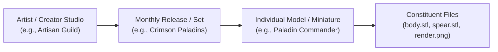

# REA-DPV-SET-BROWSING-001: Release and Collection Hero Card Experience

**Document Reference:** `docs/research/REA-DPV-SET-BROWSING-001.md`  
**Governing Standard:** `DEVELOPMENT_STANDARD.md`  
**Governing Authorities:** [`ADR-DPV-MODEL-001`](../architecture/decisions/ADR-DPV-MODEL-001.md), [`ADR-DPV-CATALOG-001`](../architecture/decisions/ADR-DPV-CATALOG-001.md), [`UI-REVIEW-003`](../reviews/UI-REVIEW-003.md).  
**Activity Scope:** Research, UX Design, and Conceptual Architecture for Creator Tribes, Monthly Releases, Set Curation, and Visual Discovery. *(Research and design only; no production code changes, no schema migrations).*

---

## 1. Executive Summary

As identified in [`UI-REVIEW-003`](../reviews/UI-REVIEW-003.md), 3D Print Vault (DPV) currently suffers from a "database of indexed files" aesthetic. While our backend ingestion pipeline successfully builds 1-to-N model clusters and file roles, the user interface presents flat cards featuring raw Windows directory paths and uniform file stamps. 

In the broader 3D printing ecosystem—exemplified by platforms like MyMiniFactory (MMF) and its Creator Tribes/Patreon ecosystem—collectors do not merely browse isolated .stl files. They collect **Campaigns, Monthly Releases, and Creator Sets** (e.g., *Artisan Guild's "The Crimson Paladins"*, *Titan-Forge's "Blood Reaper Orcs"*). 

This research establishes the design framework for introducing a **Release / Set Layer** into DPV. This transforms DPV from a cold file utility into a warm, immersive digital showcase—a true "Personal Model Collection" sanctuary.

---

## 2. Benchmark Analysis: The MyMiniFactory "Tribes & Releases" Paradigm

MyMiniFactory revolutionized 3D printing library curation by shifting away from unorganized folder trees toward **Campaign and Creator-centric curation**. Analyzing their UX reveals four critical design pillars:

1. **The Campaign/Release as the Primary Object:** Instead of presenting 50 individual monster miniatures in a flat grid, MMF groups them under a cinematic banner image representing the monthly release or Kickstarter box art.
2. **The Creator Studio (Tribes) Identity:** Creators have distinct branding (avatars, banner art, lore blurbs, and tier badges). Collectors browse by *who* made the art, not just *what* the file is called.
3. **Immersive Hero Presentation:** Release cards use widescreen or tall cinematic aspect ratios ($16:9$ or $4:3$) featuring professional painted showcase renders rather than raw CAD wireframes.
4. **Hierarchical Progressive Disclosure:** 
   $$\text{Artist / Studio} \longrightarrow \text{Monthly Release / Kickstarter Set} \longrightarrow \text{Individual Model / Miniature}$$
   Users drill down from high-level artistic themes into specific printable components.

---

## 3. How Should Releases / Sets Appear in DPV?

To bridge the gap between folder-based local storage and polished creator platforms, DPV shall introduce two distinct visual card modes in the UI gallery:

### A. The Release Hero Card (Cinematic Campaign View)
When viewing an Artist Portfolio or a Release-focused category, sets appear as **Cinematic Release Cards** rather than standard model cards.
- **Visual Anatomy:**
  - **Hero Widescreen Banner ($16:9$):** Displays the official promotional render or painted showcase image provided in the release folder (e.g., `cover.jpg` or `render_banner.webp`).
  - **Release Title & Creator Pill:** Bold typography for the set name (e.g., *"March 2026: Siege of Ironhold"*) accompanied by the creator/artist avatar.
  - **Asset Count & Completeness Badge:** A sleek pill showing model count and print readiness (`[18 Models]`, `[Pre-Supported]`).
  - **Progress / Ownership Ring:** A subtle visual indicator showing how many models from this set have been printed, painted, or queued.

### B. The Model Card (Grid View)
When drilling into a specific Release, the UI transitions to the **Model Card Grid**, displaying individual miniatures or terrain pieces belonging to that set.

---

## 4. Hero Image Selection Strategy

For locally stored collections where users have varying folder naming conventions, DPV must automatically synthesize stunning hero imagery without manual intervention:

1. **Explicit Cover Art (`100%` Precedence):** Images named `cover.*`, `banner.*`, `folder.jpg`, or specified in `.dpv.json` sidecars take absolute priority.
2. **Hero Painted Renders ($\ge 800\text{px}$):** High-resolution `.png` or `.jpg` files containing tokens like `render`, `painted`, `hero`, or `preview`.
3. **Synthesized Set Collage:** If no explicit banner exists, the UI dynamically stitches a 3-tile grid preview composed of the top 3 highest-rated models within that release folder.

---

## 5. Navigation Hierarchy: Artist $\rightarrow$ Release $\rightarrow$ Model

The DPV navigation model must mirror a collector's natural mental workflow:



- **Level 1 (Artists):** Browse by studio. View avatars, total model counts, and active series.
- **Level 2 (Releases / Sets):** Browse monthly drops, Kickstarter campaigns, or custom folders. Each release card acts as a visual portal into that batch of models.
- **Level 3 (Models):** The core printable entities (`ADR-DPV-MODEL-001`).
- **Level 4 (Files):** Underlying `.stl`, `.obj`, `.3mf`, and `.zip` assets accessible via the Inspector Panel.

---

## 6. Search Implications

Introducing a Release layer impacts the FTS5 search index and global filtering:
- **Hierarchical Tokenization:** Searching for `"Crimson Paladins"` must instantly return the Release container *and* all member models, even if individual model filenames are generic (`knight_A.stl`).
- **Contextual Facets:** Search filters can scope queries by Artist or Release Set, preventing search results from becoming an overwhelming flat list of 10,000 loose files.

---

## 7. Favorites & Curation Implications

- **Pinning Releases:** Users can favorite entire releases (e.g., bookmarking an entire Kickstarter bundle to their "Priority Print Queue").
- **Collection Tagging:** Users can group disparate models across different folders into custom virtual "Collections" (e.g., *"D&D Campaign Bosses"* or *"Sci-Fi Terrain"*), decoupled from physical disk hierarchies.

---

## 8. Navigation & UI Layout Examples

### Artist Portfolio View
```text
┌─────────────────────────────────────────────────────────────────────────────┐
│ [Avatar] ARTISAN GUILD                                     [142 Models]     │
│ High-fantasy tabletop miniatures, modular units, and monster sculpts.       │
├─────────────────────────────────────────────────────────────────────────────┤
│ RELEASES & CAMPAIGNS                                                        │
│ ┌─────────────────────────┐  ┌─────────────────────────┐  ┌───────────────┐ │
│ │                         │  │                         │  │               │ │
│ │  [ 16:9 Cinematic Art ] │  │  [ 16:9 Cinematic Art ] │  │ [ 16:9 Art ]  │ │
│ │                         │  │                         │  │               │ │
│ │ Crimson Paladins        │  │ Goblin Grotto Expansion │  │ Dragon Realm  │ │
│ │ 18 Models • Pre-Supp.   │  │ 24 Models • Terrain     │  │ 12 Models     │ │
│ └─────────────────────────┘  └─────────────────────────┘  └───────────────┘ │
└─────────────────────────────────────────────────────────────────────────────┘
```

---

## 9. Architecture & Schema Impact (`ADR-DPV-MODEL-001` Compliance)

To implement this without violating core architectural rules:
- **Models remain the Atomic Entity:** Files belong to Models (`1:N`), and Models belong logically to a Release/Set via an optional `ReleaseId` or parent collection path property in SQLite.
- **Non-Destructive Ingestion:** The discovery engine automatically infers the `Release` layer from parent folder structures (e.g., `Vault/ArtisanGuild/2026_03_CrimsonPaladins/ModelA/`) during the 7-stage synthesis pipeline, requiring **zero file moving on disk**.

---

## 10. Risks & Edge Cases

1. **Orphaned Singletons:** Models imported from flat folders without artist or release folder structures must gracefully default to a "General / Unassigned" virtual release container.
2. **Deeply Nested Folders:** Overly complex directory nesting (e.g., `Root/Artist/GameSystem/Faction/Subfaction/Set/Model`) risks flattening or over-clustering. The engine must cap hierarchy traversal at 3 parent levels.

---

## 11. Comprehensive Recommendations for Sprint 6 UI

1. **Implement a Tabbed Library View:** Provide toggle pills at the top of the workspace: `[ All Models ]  [ Releases & Sets ]  [ Artists ]  [ Favorites ]`.
2. **Card Grid Redesign:** Build a responsive `WrapPanel` card template featuring $16:9$ preview banners for Release cards and square/portrait cards for individual models.
3. **Purge Raw Paths from UI:** Strip all absolute Windows file paths (`C:\...`) from primary card views, relegating technical diagnostics strictly to the Inspector's debug tab.
4. **Creator Avatars:** Automatically generate styled initials or load studio badges for known creators in the Artist sidebar.

---

## 12. Answers to Final Questions

- **Should DPV introduce a Release / Set layer?**  
  *Yes.* It is the fundamental missing link that bridges physical folder structures with how collectors actually think about their miniatures.
- **Should Set Hero Cards exist?**  
  *Yes.* Cinematic release cards are essential for visual discovery and breaking up the monotony of flat model grids.
- **Should users browse Artist $\rightarrow$ Model or Artist $\rightarrow$ Release $\rightarrow$ Model?**  
  *Artist $\rightarrow$ Release $\rightarrow$ Model.* This hierarchical drill-down prevents cognitive overload when viewing massive creator catalogs containing hundreds of sculpts.
- **What best supports a collector's mindset?**  
  *Campaign curation, studio branding, release artwork, and custom favorites/queues.*
- **What best supports visual discovery?**  
  *High-impact hero banners, painted showcase renders, and card grid density scaling (S/M/L).*

---

## 13. Final Verdict

Introducing the **Release and Collection Hero Card Experience** elevates DPV from an automated file-indexing database into a true digital sanctuary. It honors our backend model-centric architecture while delivering the immersive, art-gallery-grade presentation collectors expect.
