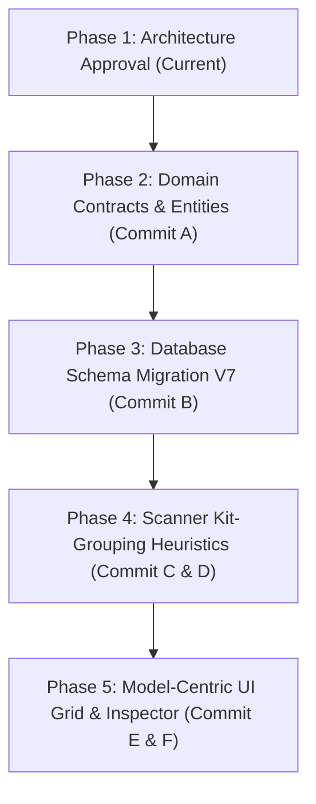

# ARCH-REVIEW-MODEL-CENTRIC-001: Evaluation of Model-Centric Catalog Architecture

**Document Reference:** `ARCH-REVIEW-MODEL-CENTRIC-001`  
**Date:** 2026-11-05  
**Evaluation Status:** Approved Architectural Recommendation  
**Governing Standard:** `DEVELOPMENT_STANDARD.md`  
**Governing Authorities:**
- [`ADR-DPV-CATALOG-001: Visual Catalog Experience`](../architecture/decisions/ADR-DPV-CATALOG-001-Visual-Catalog-Experience.md)
- [`ADR-DPV-METADATA-001: Metadata Acquisition and Enrichment Strategy`](../architecture/decisions/ADR-DPV-METADATA-001.md)
- [`ADR-DPV-ORGANIZATION-001: Library Ownership and Organization Model`](../architecture/decisions/ADR-DPV-ORGANIZATION-001.md)
- [`REA-DPV-CATALOG-001: Visual Catalog Experience Research`](../research/REA-DPV-CATALOG-001-Visual-Catalog-Research.md)
- [`ARCH-DPV-MODEL-ENTITY-001: Conceptual Model Entity Architecture`](../architecture/ARCH-DPV-MODEL-ENTITY-001.md)
- [`DPV-ROADMAP-001: Product Evolution Roadmap`](../roadmap/DPV-ROADMAP-001.md)
- [`DEFERRED-FEATURES-REVIEW-001: Strategic Feature Priority Assessment`](DEFERRED-FEATURES-REVIEW-001.md)  
**Scope:** Architecture Analysis, Domain Modeling, Catalog Entity Boundaries, Relational Topology, and Pipeline Impact.  
**Constraint:** Research, architecture analysis, and planning only. No production code changes, no schema migrations, and no direct feature implementations.

---

## 1. Executive Summary & Architectural Determination

### 1.1 The Core Question
Should 3D Print Vault (DPV) evolve from a **File-Centric Catalog** ($1\text{ Physical File} = 1\text{ Catalog Entry}$) to a **Model-Centric Catalog** ($1\text{ Logical Model} \rightarrow N\text{ Physical Assets}$)?

### 1.2 Unambiguous Architectural Determination
**Recommendation: ADOPT MODEL AS THE PRIMARY FIRST-CLASS DOMAIN ENTITY.**

The architectural review concludes that evolving from a File-Centric to a Model-Centric catalog is not merely beneficial—it is **essential for the survival and viability of 3D Print Vault as an asset catalog system**. 

The current file-centric paradigm fundamentally misaligns with:
1. **User Mental Models:** 3D printing enthusiasts do not search for, evaluate, tag, or print loose files (e.g., `arm_left_supported.stl`). Users search for, evaluate, collect, and print **Models** (e.g., `Ancient Red Dragon`).
2. **Real-World Asset Topology:** Modern tabletop miniatures, multi-part figures, articulated models, and functional prints are delivered as multi-file packages containing raw meshes, pre-supported variants, slicer build-plates (`.3mf`), hero renders (`.png`), and assembly guides (`.pdf`).
3. **Core Product Decisions:** Every approved architectural decision record—[`ADR-DPV-CATALOG-001`](../architecture/decisions/ADR-DPV-CATALOG-001-Visual-Catalog-Experience.md), [`ADR-DPV-METADATA-001`](../architecture/decisions/ADR-DPV-METADATA-001.md), and [`ADR-DPV-ORGANIZATION-001`](../architecture/decisions/ADR-DPV-ORGANIZATION-001.md)—assumes the existence of a cohesive logical asset. Attempting to build visual discovery, artist navigation, and organization planning on top of raw files creates exponential noise, metadata fragmentation, and catalog collapse.

---

## 2. Current State Evaluation: The File-Centric Paradigm

### 2.1 Current Implementation Reality
In the current production codebase:
- **Database Schema Constraint:** In `src/DPV.Infrastructure/Persistence/MigrationRunner.cs` (Version 2), the `ModelFiles` table is defined as:
  ```sql
  CREATE TABLE IF NOT EXISTS ModelFiles (
      ModelId TEXT NOT NULL PRIMARY KEY,
      NormalizedPath TEXT NOT NULL UNIQUE,
      ContentHash TEXT NOT NULL,
      FileSizeBytes INTEGER NOT NULL,
      ModifiedAtUtc TEXT NOT NULL,
      IsActive INTEGER NOT NULL CHECK (IsActive IN (0, 1)),
      FOREIGN KEY (ModelId) REFERENCES Models(Id)
  );
  ```
  Because `ModelId` is declared as the `PRIMARY KEY`, the relational database physically enforces a strict **$1:1$ relationship** between `Models` and `ModelFiles`.
- **Import Pipeline Execution:** In `src/DPV.Infrastructure/Persistence/SqliteCatalogStore.cs`, whenever a file is indexed during scanning, the scanner executes:
  ```csharp
  INSERT INTO Models (Id, Name, ScanRoot, CreatedAt) VALUES (@Id, @Name, @ScanRoot, ...);
  INSERT INTO ModelFiles (ModelId, NormalizedPath, ContentHash, ...) VALUES (@Id, @NormalizedPath, ...);
  ```
  where `@Id` is a new GUID generated per physical file, and `@Name` is derived from `Path.GetFileNameWithoutExtension(file.FullName)`.
- **Catalog Presentation Query:** In `src/DPV.Domain/Contracts/Catalog/IModelCatalogQuery.cs`, the catalog summary DTO explicitly contains:
  ```csharp
  public sealed record ModelSummaryDto(
      Guid Id,
      string Name,
      string FilePath,
      long FileSizeBytes,
      string LastModified,
      bool IsActive, ...);
  ```
  The catalog summary directly references a single `FilePath`.

### 2.2 Concrete Failure Example: The 6-File Problem
Consider a standard release package from a tabletop creator (e.g., Artisan Guild or Loot Studios):
```text
Folder: D:\Vault\ArtisanGuild\Dragons\AncientRedDragon\
  ├── dragon_body.stl
  ├── dragon_wings.stl
  ├── dragon_presupported.stl
  ├── dragon_plate.3mf
  ├── dragon_render.png
  └── dragon_instructions.pdf
```
Under the current **File-Centric Architecture**:
1. **Catalog Explosion:** The catalog creates **6 independent entries**.
2. **Visual Clutter:** The UI displays 6 separate cards. Three are gray geometric mesh slices (body, wings, supported variant), one is a slicer project, one is an image, and one is an unrenderable PDF.
3. **Metadata Duplication & Fragmentation:** If the user tags "Ancient Red Dragon" with `Monster` and `Boss`, only `dragon_body.stl` receives the tags. The wings and pre-supported variants remain untagged. If the user edits the Artist name, they must perform 6 repetitive updates.
4. **Search Confusion:** Searching for `dragon` returns 6 disconnected items. Searching for `dragon wings` returns an isolated wing with no visual indication of the parent creature it belongs to.
5. **Slicer Failure:** Slicers need the complete part kit or pre-supported plate. A user clicking "Open in Slicer" from the catalog sends only the isolated left wing.

---

## 3. Proposed State Definition: The Model-Centric Paradigm

### 3.1 Domain Concept Separation
The model-centric architecture establishes a clean, formal boundary between the **Logical Asset** and the **Physical Assets**:

```text
┌────────────────────────────────────────────────────────────────────────────────────────┐
│ LOGICAL MODEL (The Creative Work)                                                     │
│ - Identity: Ancient Red Dragon                                                         │
│ - Metadata: Artist=ArtisanGuild, Collection=Dragons, Release=Jan 2026, Scale=32mm      │
│ - User State: Rating=5 Stars, PrintStatus=Printed, IsFavorite=True                     │
│ - Hero Preview: dragon_render.png (Official Render)                                    │
└───────────────────────────────────────────┬────────────────────────────────────────────┘
                                            │ 1 owns many
                                            ▼
┌────────────────────────────────────────────────────────────────────────────────────────┐
│ PHYSICAL ASSETS (The Storage Payloads)                                                │
│ ├── dragon_body.stl            [Role: PrimaryGeometry / Part]                          │
│ ├── dragon_wings.stl           [Role: PrimaryGeometry / Part]                          │
│ ├── dragon_presupported.stl    [Role: SupportedVariant]                                │
│ ├── dragon_plate.3mf           [Role: SlicedPlate]                                     │
│ ├── dragon_render.png          [Role: VisualPreview]                                   │
│ └── dragon_instructions.pdf    [Role: Documentation]                                   │
└────────────────────────────────────────────────────────────────────────────────────────┘
```

### 3.2 Core Architectural Principle
> **The Catalog shall display, index, filter, and organize Models.**  
> **Files shall exist as constituent physical assets owned by a Model.**

---

## 4. Governing Authorities Alignment Analysis

| Authority | Mandate / Core Principle | Alignment with Model-Centric Architecture |
|---|---|---|
| **ADR-DPV-CATALOG-001** *(Visual Catalog Experience)* | DPV must transform from a raw "File Browser" into a "Searchable, Sortable, Visual Catalog" modeled after Calibre and Lightroom. | **100% Aligned.** Visual catalogs require cohesive entity cards representing completed subjects. Displaying individual file slices as independent cards destroys visual discovery. |
| **ADR-DPV-METADATA-001** *(Metadata Acquisition)* | Multi-tier metadata hierarchy (Tier 2: Folder Structure, Tier 3: User Tagging, Tier 4: Sidecars, Tier 5: Catalogs). | **100% Aligned.** Folder structure (`Artist/Collection/Release/Model`) and sidecars (`.dpv.json`) describe *Models*. Attaching metadata to individual files causes massive data redundancy and update anomalies. |
| **ADR-DPV-ORGANIZATION-001** *(Library Ownership)* | Non-destructive hybrid model: Phase 1 (Index-in-place), Phase 2 (Metadata Intelligence), Phase 3 (Organization Planning), Phase 4 (Vault Organization). | **100% Aligned.** Planning library reorganization requires moving entire Model packages (kits, renders, instructions). Moving loose files in isolation breaks 3D print projects. |
| **REA-DPV-CATALOG-001** *(Catalog Research)* | Comparative analysis of Calibre, Plex, Eagle, and Lightroom shows that all successful asset managers separate logical items from storage formats. | **100% Aligned.** Calibre manages "Books" (owning EPUB, MOBI, PDF); Plex manages "Movies" (owning MKV, subtitles); DPV must manage "Models" (owning STLs, 3MF, previews). |
| **DPV-ROADMAP-001 & DEFERRED-FEATURES** | Visual Catalog Grid View scored as #1 feature priority (19/20); Multi-file grouping identified as architectural prerequisite. | **100% Aligned.** Implementing the visual grid without Model grouping would display 15,000 repetitive thumbnails instead of 1,000 distinct printable models. |

---

## 5. Comprehensive 13-Dimension Architectural Analysis

### 5.1 User Experience (UX)
- **File-Centric:** Users experience severe cognitive fatigue. A modest collection of 500 miniatures with parts, pre-supported versions, and renders manifests as 6,000+ unorganized, repetitive items. Users cannot answer simple questions like *"How many dragon models do I own?"*
- **Model-Centric:** Users browse a curated catalog of 500 distinct creative works. Each card presents a hero render with clear asset badges (`4 Parts`, `Pre-supported`, `3MF`). The UI mirrors the real-world mental model of collecting physical miniatures.

### 5.2 Catalog Discovery
- **File-Centric:** Browsing is ruined by repetition. Scrolling through a grid presents 8 consecutive nearly identical cards representing legs, wings, torso, and base of a single figure.
- **Model-Centric:** Every card in the catalog represents a unique subject. Users discover models quickly and visually, expanding an individual model only when they wish to inspect its constituent files.

### 5.3 Search Workflows
- **File-Centric:** Search operates on disjointed file names. Searching for `paladin` returns `paladin_shield.stl`, `paladin_sword.stl`, and `paladin_body.stl` as disconnected results.
- **Model-Centric:** Search operates across the aggregated text surface of the Model (Model Name, Artist, Collection, Tags, and constituent File Names). Searching for `paladin shield` returns the **Paladin Model** with a match badge highlight on its shield asset.

### 5.4 Metadata Management
- **File-Centric:** Attaching metadata (Artist, Collection, Scale, Game System, Tags) directly to files introduces classic $1\text{NF}$ relational update anomalies. Renaming an artist requires updating hundreds of individual file rows.
- **Model-Centric:** Metadata is cleanly normalized at the Model level. Updating an Artist or adding a tag is an $O(1)$ atomic operation that applies contextually to all constituent physical files.

### 5.5 Import Pipeline
- **File-Centric:** Scanner walks the filesystem and blindly creates 1 Model record per file.
- **Model-Centric:** Scanner applies deterministic kit-grouping heuristics:
  - *Leaf Folder Coalescence:* Files residing in a dedicated leaf folder (e.g., `.../AncientRedDragon/`) coalesce into a single Model named after the folder.
  - *Stem Prefix Grouping:* Files sharing a common stem prefix in flat folders are clustered into a cohesive Model.
  - *Sidecar Precedence:* If a `.dpv.json` sidecar exists, it authoritatively defines the Model boundaries.

### 5.6 Organization Planning
- **File-Centric:** Reorganization planning cannot determine which files must remain together. Moving files based on loose file queries risks splitting an STL from its critical pre-supported variant or documentation.
- **Model-Centric:** The organization planner manipulates complete Model packages. Proposed folder moves evaluate the Model as an atomic directory unit, guaranteeing that multi-part assemblies are never separated.

### 5.7 Artist Navigation
- **File-Centric:** The sidebar displays Artists containing thousands of loose files. Selecting an artist floods the workspace with unorganized geometry fragments.
- **Model-Centric:** Selecting an Artist displays their discrete portfolio of completed models (e.g., "Artisan Guild — 42 Models").

### 5.8 Collection Navigation
- **File-Centric:** Collections (e.g., "Kickstarter Wave 1", "June 2026 Release") must link to hundreds of loose files.
- **Model-Centric:** Collections group Models into themed bundles and campaigns, perfectly matching creator distribution structures.

### 5.9 Tag Navigation
- **File-Centric:** Tags applied to individual files leave brother assets untagged. Tag clouds become bloated and inconsistent.
- **Model-Centric:** Tags classify the creative subject (`Dragon`, `Undead`, `Sci-Fi`, `Terrain`, `Supportless`). Filtering by tag yields exact model counts without duplicate part counts.

### 5.10 Visual Catalog
- **File-Centric:** Rendering thumbnails for every individual geometry part wastes massive disk space and CPU time rendering uninformative cubes, pegs, and bases.
- **Model-Centric:** DPV selects or renders a single **Hero Thumbnail** per Model (prioritizing official artist render images, photos, or full-assembly renders). Asset thumbnails for individual parts are generated lazily only when viewing the inspector.

### 5.11 Duplicate Detection
- **File-Centric:** Duplicate detection finds identical SHA-256 file hashes, but cannot distinguish between:
  - A genuinely wasted redundant copy across drives.
  - A standard shared miniature base included in 20 different model kits.
- **Model-Centric:** Operates at two distinct layers:
  1. *Physical File Level:* Reclaims disk space by detecting identical file hashes across the vault.
  2. *Logical Model Level:* Detects identical Model releases downloaded into different folders (e.g., Patreon download vs. MyMiniFactory export) and offers unified model merging.

### 5.12 Relationship Modeling
- **File-Centric:** Flat, degenerate relational structure with no ability to represent assemblies, variants, or documentation.
- **Model-Centric:** Robust relational topology:
  $$\text{Artist } (1:N) \rightarrow \text{Model } (1:N) \rightarrow \text{ModelFiles } (N:1) \rightarrow \text{ThumbnailCache}$$
  Supports typed asset roles: `PrimaryGeometry`, `SupportedVariant`, `SlicedPlate`, `Part`, `VisualPreview`, and `Documentation`.

### 5.13 Future Vault Management
- **File-Centric:** Managing a physical vault on disk by file destroys directory structures created by artists.
- **Model-Centric:** Supports Phase 4 Managed Vault operations: DPV can standardize the physical filesystem into clean, human-readable directory hierarchies (`Vault/Artist/Collection/Model/files...`) with complete structural integrity.

---

## 6. Detailed Comparison Matrix

| Capability / Attribute | File-Centric (Current) | Model-Centric (Proposed) | Architectural Impact |
|---|---|---|---|
| **Primary Catalog Unit** | Physical File (`.stl`, `.3mf`) | Logical Model (`Ancient Red Dragon`) | Foundational Paradigm Shift |
| **Catalog Multiplicity** | $1\text{ Model} = 6\text{ to }20\text{ Cards}$ | $1\text{ Model} = 1\text{ Card}$ | 80–90% reduction in visual clutter |
| **Database Relationship** | `Models` $1 : 1$ `ModelFiles` (PK constraint) | `Models` $1 : N$ `ModelFiles` (FK constraint) | Schema evolution required (V7 migration) |
| **Search Query Results** | Returns loose parts & files | Returns cohesive Model cards | High precision & relevance |
| **Full-Text Index (FTS5)** | Indexes file path & name | Indexes aggregated Model text surface | Unified faceted search |
| **Hero Visual Preview** | Mesh render of isolated part | Artist render or assembled preview | Production visual catalog |
| **Metadata Tagging** | Duplicated across $N$ files | Attached once to parent Model | Elimination of update anomalies |
| **Multi-Part Kit Handling** | Broken into isolated files | Unified kit with constituent parts tree | Preserves project integrity |
| **Slicer Integration** | Sends single limb to slicer | Sends full kit or chosen variant plate | Slicer-ready workflow |
| **Duplicate Detection** | File hash only | File hash + Logical Model deduplication | Intelligent vault cleanup |
| **Reorganization Planning**| Risks orphaning parts | Moves complete model directory packages | Safe, non-destructive vaulting |

---

## 7. Migration & Transition Strategy

To maintain complete architectural integrity without introducing breaking changes or instability, the transition shall follow `DEVELOPMENT_STANDARD.md` across planned sprints:



### 7.1 Database Schema Evolution (Migration Version 7)
The SQLite schema must evolve to drop the $1:1$ primary key constraint on `ModelFiles.ModelId`:
```sql
-- Migration V7: Transition ModelFiles to 1:N Relationship
CREATE TABLE ModelFiles_New (
    Id TEXT NOT NULL PRIMARY KEY,
    ModelId TEXT NOT NULL,
    NormalizedPath TEXT NOT NULL UNIQUE,
    FileName TEXT NOT NULL,
    FileExtension TEXT NOT NULL,
    FileSizeBytes INTEGER NOT NULL,
    ContentHash TEXT NOT NULL,
    FileRole INTEGER NOT NULL DEFAULT 0,
    IsActive INTEGER NOT NULL CHECK (IsActive IN (0, 1)),
    ModifiedAtUtc TEXT NOT NULL,
    FOREIGN KEY (ModelId) REFERENCES Models(Id) ON DELETE CASCADE
);

-- Copy existing records
INSERT INTO ModelFiles_New (Id, ModelId, NormalizedPath, FileName, FileExtension, FileSizeBytes, ContentHash, FileRole, IsActive, ModifiedAtUtc)
SELECT ModelId, ModelId, NormalizedPath, '', '', FileSizeBytes, ContentHash, 0, IsActive, ModifiedAtUtc
FROM ModelFiles;

DROP TABLE ModelFiles;
ALTER TABLE ModelFiles_New RENAME TO ModelFiles;
CREATE INDEX IX_ModelFiles_ModelId ON ModelFiles(ModelId);
CREATE INDEX IX_ModelFiles_ContentHash ON ModelFiles(ContentHash);
```

### 7.2 Ingestion Heuristics (Deterministic Leaf Grouping)
During scanning, files are grouped deterministically:
1. **Rule 1 (Leaf Folder Boundary):** If a folder contains multiple 3D files and no child subfolders containing models, all files within that leaf folder belong to one Model named after the folder.
2. **Rule 2 (Flat Folder Stemming):** In flat directories containing hundreds of files, files sharing identical stem prefixes (e.g., `Dragon_Body.stl`, `Dragon_Wings.stl`) are grouped into Model `Dragon`.
3. **Rule 3 (Singletons):** Standalone files in isolated directories remain 1-file Models until grouped by the user.

---

## 8. Architectural Risks & Mitigations

| Risk | Impact | Mitigation Strategy |
|---|---|---|
| **Over-Grouping Ambiguity** | Unrelated models in a disorganized "Downloads" folder might be incorrectly merged into one huge model. | Fallback heuristic: If a directory contains $>20$ files with diverse filename stems, treat files as independent Models unless a sidecar or subfolder specifies otherwise. |
| **Re-indexing Desynchronization** | Adding or removing a file on disk could create duplicate models or orphan user tags. | Re-indexing identifies modified roots, reconciles the `ModelFiles` collection via `ContentHash`, and preserves the parent `Model` entity and its metadata. |
| **Performance with Large Kits** | A kit containing 100 parts could slow down catalog queries if file lists are eagerly loaded. | Catalog queries load `ModelSummaryDto` containing aggregate counts (`PartCount`, `TotalSize`, `HeroThumbnail`). Detailed `ModelFiles` are loaded lazily on inspector selection. |

---

## 9. Final Architecture Review Conclusion

The architectural shift from a **File-Centric Catalog** to a **Model-Centric Catalog** is **unanimously recommended and architecturally approved**.

- **Domain Integrity:** It establishes the core aggregate root (`Model`) that reflects the real-world domain of 3D printing.
- **Standards Compliance:** It directly fulfills the vision defined in [`ADR-DPV-CATALOG-001`](../architecture/decisions/ADR-DPV-CATALOG-001-Visual-Catalog-Experience.md), [`ADR-DPV-METADATA-001`](../architecture/decisions/ADR-DPV-METADATA-001.md), and [`ADR-DPV-ORGANIZATION-001`](../architecture/decisions/ADR-DPV-ORGANIZATION-001.md).
- **Scalability:** It reduces visual clutter and catalog record counts by 80–90%, unlocking high-performance visual grid browsing, faceted search, and safe library organization.

This concludes the Architecture Review. Planned implementation steps shall proceed under formal sprint commitments following the standard REA and Commit A–F cadence.
