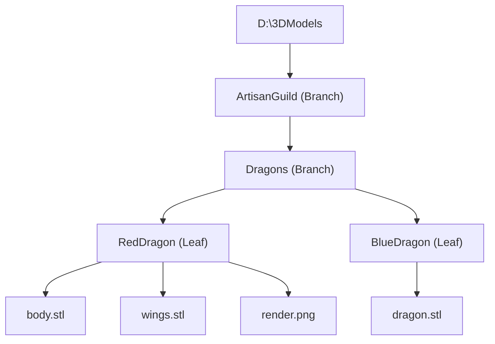
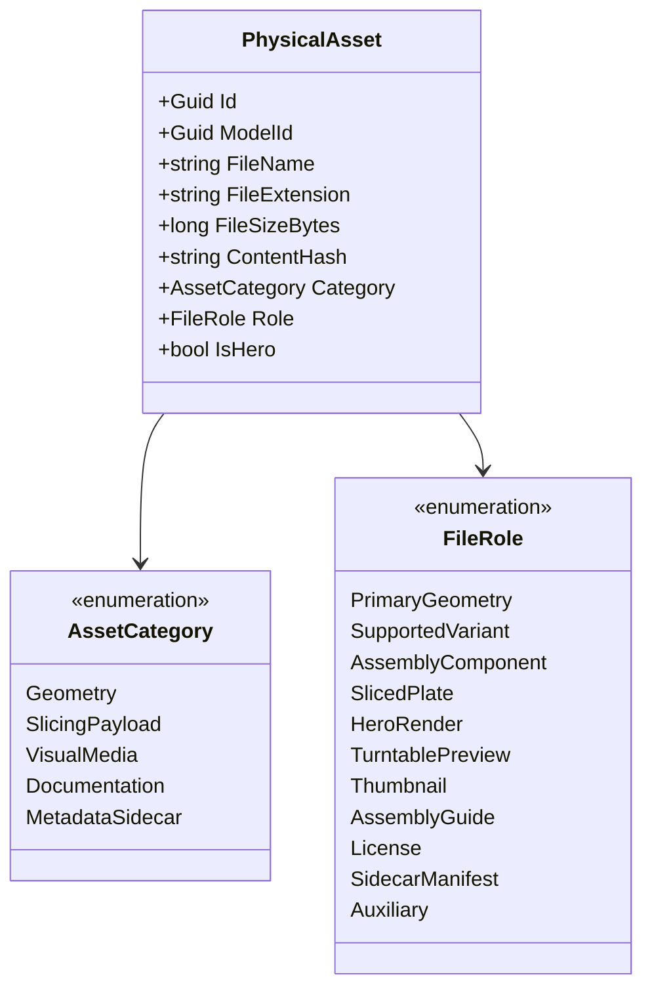
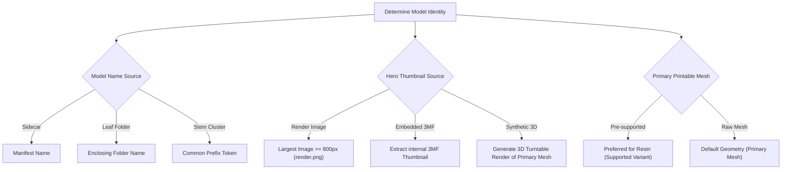

# MODEL-DISCOVERY-REVIEW-001: Research & Evaluation of Model Discovery and File Grouping Strategies

**Document Reference:** `MODEL-DISCOVERY-REVIEW-001`  
**Date:** 2026-11-06  
**Status:** Approved Research & Evaluation Activity (REA)  
**Governing Standard:** `DEVELOPMENT_STANDARD.md`  
**Governing Authorities:**
- [`ADR-DPV-MODEL-001: Model as the Primary Catalog Entity`](../architecture/decisions/ADR-DPV-MODEL-001.md)
- [`ADR-DPV-CATALOG-001: Visual Catalog Experience`](../architecture/decisions/ADR-DPV-CATALOG-001-Visual-Catalog-Experience.md)
- [`ADR-DPV-METADATA-001: Metadata Acquisition and Enrichment Strategy`](../architecture/decisions/ADR-DPV-METADATA-001.md)
- [`ADR-DPV-ORGANIZATION-001: Library Ownership and Organization Model`](../architecture/decisions/ADR-DPV-ORGANIZATION-001.md)
- [`REA-DPV-CATALOG-001: Visual Catalog Experience Research`](../research/REA-DPV-CATALOG-001-Visual-Catalog-Research.md)
- [`ARCH-REVIEW-MODEL-CENTRIC-001: Model-Centric Catalog Architecture Review`](ARCH-REVIEW-MODEL-CENTRIC-001.md)  
**Scope:** Ingestion Pipeline, Asset Grouping Heuristics, Conflict Resolution, Confidence Scoring, Asset Classification Taxonomy.  
**Constraint:** Research, architecture analysis, and design only. No production code changes, no database schema changes, and no direct feature implementations.

---

## 1. Executive Summary

With the formal acceptance of [`ADR-DPV-MODEL-001`](../architecture/decisions/ADR-DPV-MODEL-001.md), 3D Print Vault (DPV) established its core product principle:
> **Users discover Models. Users store Files.**

Historically, DPV operated as a flat file indexer ($1\text{ File} = 1\text{ Catalog Item}$), which strictly indexed `.stl` files and ignored supporting assets. Under [`ADR-DPV-MODEL-001`](../architecture/decisions/ADR-DPV-MODEL-001.md), the catalog must aggregate multiple constituent physical files—raw geometry, pre-supported variants, sliced build plates (`.3mf`), hero renders (`.png`), assembly instructions (`.pdf`), and license documents—into a single logical **Model**.

The fundamental unresolved engineering problem is:  
**How does an arbitrary, unorganized, or semi-organized collection of physical files on disk become a Model during import without data loss or user disruption?**

This Research & Evaluation Activity evaluates seven candidate grouping strategies, designs a deterministic multi-stage discovery hierarchy, establishes an asset classification taxonomy, defines a mathematical model confidence scoring rubric, formulates conflict-resolution rules, and specifies the reformed import pipeline architecture.

---

## 2. Problem Definition: The Semantic Gap Between Files and Models

### 2.1 The Reality of User 3D Printing Libraries
Unlike commercial music or movie files that contain standardized internal metadata headers (ID3 tags in MP3s, Atom tags in MP4s), raw 3D printing assets (`.stl`, `.obj`) contain zero semantic authoring metadata. Files are distributed by creators (Patreon, Tribes, Kickstarter, MyMiniFactory) across a chaotic spectrum of organization patterns:

```text
Pattern A: Deep Clean Hierarchy (Leaf Folder Kits)
/ArtisanGuild/2026-01-Dragons/AncientRedDragon/
  ├── dragon_head.stl
  ├── dragon_wings.stl
  ├── dragon_head_supported.stl
  ├── dragon_render.png
  └── guide.pdf

Pattern B: Flat Multi-Kit Dumps
/Downloads/Miniatures/
  ├── paladin_body.stl
  ├── paladin_sword.stl
  ├── paladin_render.jpg
  ├── goblin_archer_presupported.stl
  ├── goblin_archer_raw.stl
  └── goblin_archer_render.png

Pattern C: Subdirectory Split Kits
/TitanForge/SciFiTroopers/
  ├── Unsupported/
  │   ├── trooper1.stl
  │   └── trooper2.stl
  ├── Supported/
  │   ├── trooper1_supp.stl
  │   └── trooper2_supp.stl
  └── Renders/
      └── preview.jpg
```

### 2.2 The Risk of Naive Grouping
1. **Over-Grouping (False Merging):** Aggressively merging an entire directory of 100 unrelated scatter terrain pieces or a flat "Downloads" folder into a single gigantic model titled "Downloads" with 100 disconnected parts.
2. **Under-Grouping (Catalog Fragmentation):** Falling back to single-file models whenever ambiguity arises, flooding the catalog with thousands of isolated wings, heads, and pre-supported rafts.
3. **Destructive Ambiguity:** Splitting pre-supported variants from their raw counterparts, rendering slicing and printing workflows broken.

---

## 3. Discovery Strategy Evaluation

Seven distinct discovery mechanisms were analyzed across five critical criteria:

| Strategy | Primary Mechanism | Advantages | Disadvantages | Confidence Level | Complexity | Failure Mode |
|---|---|---|---|---|---|---|
| **1. Leaf Folder Rule** | Enclosing directory acts as model boundary | Matches 80%+ of Patreon/Tribes releases; natural human organization | Fails in flat folders or nested multi-folder kits (`/Supported/`, `/Unsupported/`) | High (85–95%) | Low | Merges multiple models if dumped into one folder |
| **2. File Stem Rule** | Common filename prefix token clustering | Works in flat directories; groups `dragon_body` and `dragon_wings` | Highly sensitive to varied naming styles, delimiters, and numbers | Medium (60–75%) | Medium | False splits (e.g., `body.stl` vs `wings.stl` without stem) |
| **3. Archive Rule** | Files sharing identical zip/rar source origin | Preserves creator packaging boundaries exactly as delivered | Uncompressed files lose heritage; nested zip-in-zip complexity | Very High (90–98%) | Medium-High | Large "Mega-Bundles" (50 models in 1 zip) over-group |
| **4. Sidecar Rule** | Explicit manifest file (`.dpv.json` or `.json`) | 100% deterministic, portable, reproducible, user-controllable | Rarely provided by creators upfront; requires generation | Absolute (100%) | Low | Missing or corrupted JSON manifests |
| **5. Metadata Rule** | Upstream creator/store API or folder taxonomy | Links releases to verified external catalogs (MMF, Thingiverse) | Requires network/catalog matching; useless for offline custom files | High (80–90%) | High | False matches on generic names (e.g. "Dragon") |
| **6. Thumbnail Rule** | Shared image proximity or naming | Renders act as anchors for 3D meshes sharing folder/stem | Many kits lack renders or use generic `preview.jpg` | Medium (50–70%) | Medium | Multiple renders in one folder create confusion |
| **7. Manual Grouping**| Explicit user selection & assignment | 100% accurate; provides ultimate user sovereignty | Labor-intensive; does not scale to 20,000+ files automatically | Absolute (100%) | Low-Medium | User fatigue if automated discovery fails |

---

## 4. Deep Dive: Folder Rule Analysis

### 4.1 Leaf Folder Mechanics
A **Leaf Folder** is defined as a directory that contains printable assets and has **no child subdirectories containing additional printable assets**.



### 4.2 Handling Nested "Variant" Subfolders
A common failure of strict leaf folder logic occurs when creators organize by variant folders inside a single model kit:
```text
/AncientRedDragon/
  ├── Unsupported/
  │   ├── body.stl
  │   └── wings.stl
  └── Supported/
      ├── body_supported.stl
      └── wings_supported.stl
```
If evaluated strictly as individual leaf folders, DPV would create **two separate models**: `"Unsupported"` and `"Supported"`.

**The Structural Collapsing Rule:**  
Subdirectories matching reserved variant names (`Supported`, `Unsupported`, `Pre-supported`, `Presupported`, `Parts`, `Mesh`, `Renders`, `Images`, `Docs`) are **virtual child branches**. They are collapsed into the immediate parent folder (`AncientRedDragon`), ensuring all files remain in one unified Model.

### 4.3 Handling Flat "Mega-Folders"
When a folder contains more than 15 printable files AND does not exhibit common naming prefixes, treating the folder as a single leaf model causes disastrous over-grouping.  
*Rule:* If asset count $> 15$ and stem variance $> 0.6$, the Leaf Folder rule is downgraded, triggering the File Stem Clustering engine.

---

## 5. Deep Dive: Stem Rule Analysis

### 5.1 Tokenization & Stem Extraction
Files in flat folders frequently share common stems separated by delimiters (`_`, `-`, `.`, spaces, CamelCase).
The stem extraction algorithm operates as follows:
1. **Filename Sanitization:** Remove extensions (`.stl`, `.3mf`, `.png`).
2. **Suffix Stripping:** Strip standardized 3D printing variant tokens:
   - `_supported`, `_presupported`, `_pre`, `_supp`, `_lys`, `_chitubox`
   - `_v1`, `_v2`, `_repaired`, `_scaled`
   - `_part\d+`, `_piece\d+`, `_head`, `_torso`, `_legs`, `_arm[LR]`, `_base`
3. **Delimiter Tokenization:** Split remaining string into tokens.
4. **Longest Common Prefix (LCP) Clustering:** Group files in the same directory that share an identical normalized prefix of $\ge 4$ characters.

### 5.2 Failure Modes and Guardrails
- **The Generic Collision Problem:**  
  Files named `base_25mm.stl`, `base_32mm.stl`, `base_50mm.stl` share the stem `base_`. Grouping them would combine three independent miniature bases into one model.  
  *Guardrail:* Reserved generic nouns (`base`, `stand`, `wall`, `floor`, `tile`, `weapon`, `door`, `crate`) are excluded from solitary stem grouping unless accompanied by a qualifying project token.
- **International & Non-Latin Character Sets:**  
  Unicode normalization (NFC) must be enforced prior to stem extraction to prevent character mismatch across UTF-8 file paths.

---

## 6. Deep Dive: Archive Rule Analysis

### 6.1 Archive Heritage Tracking
Over 70% of 3D printing assets enter a user's library as `.zip`, `.rar`, or `.7z` packages.
1. **Direct In-Archive Indexing:** Reading zip central directories allows DPV to identify model boundaries prior to extraction.
2. **Extracted Heritage (Manifest Tracking):** When DPV extracts or monitors folder unpacking, an archive manifest tag associates all unpacked items with the parent archive name.
3. **Single Model Archives vs. Collection Archives:**
   - Archives containing $\le 1$ kit folder $\rightarrow$ 1 Model named after the Archive.
   - Archives containing multiple root folders (e.g. "Release_January.zip") $\rightarrow$ The archive acts as a **Collection/Release**, and each subfolder acts as a **Model**.

---

## 7. Deep Dive: Sidecar Rule Analysis

### 7.1 Authoritative Sidecars (`.dpv.json`)
Per [`ADR-DPV-METADATA-001`](../architecture/decisions/ADR-DPV-METADATA-001.md), explicit sidecar files provide **100% deterministic grouping**.
```json
{
  "schemaVersion": 1,
  "modelId": "9b1deb4d-3b7d-4bad-9bdd-2b0d7b3dcb6d",
  "name": "Ancient Red Dragon",
  "artist": "Artisan Guild",
  "collection": "Dragons of the Red Peak",
  "scale": "32mm",
  "primaryAsset": "dragon_body.stl",
  "heroThumbnail": "dragon_render.png",
  "assets": [
    { "path": "dragon_body.stl", "role": "AssemblyComponent" },
    { "path": "dragon_wings.stl", "role": "AssemblyComponent" },
    { "path": "dragon_presupported.stl", "role": "SupportedVariant" },
    { "path": "dragon_plate.3mf", "role": "SlicedPlate" },
    { "path": "dragon_render.png", "role": "HeroRender" },
    { "path": "assembly_guide.pdf", "role": "Documentation" }
  ],
  "tags": ["dragon", "monster", "huge", "boss"]
}
```
### 7.2 Portability and Zero Lock-In
When sidecars are placed adjacent to model files, moving or sharing the folder preserves the complete model definition across different DPV installations without requiring database exports.

---

## 8. Deep Dive: Manual Grouping Analysis

### 8.1 The User Sovereignty Requirement
No automated heuristic can ever be 100% accurate across messy, edge-case libraries. Manual user assignment is the definitive fallback:
1. **Multi-Select "Group into Model":** User selects any collection of files in the UI and clicks `Group as Model`.
2. **"Ungroup / Split Model":** User splits an over-grouped model back into individual items or sub-models.
3. **"Extract Part to New Model":** User pulls one file out into its own model.
4. **Immutable Persistence:** Once a user manually groups or confirms a model, its status transitions to `UserVerified`. The automated scanner is permanently forbidden from dismantling or re-clustering that model during subsequent scans.

---

## 9. Comprehensive Asset Classification Model

Every physical file indexed by DPV must be classified into a typed **File Role** based on extension, naming conventions, and file headers:



### 9.1 Asset Classification Taxonomy

| Category | File Extensions | Role Detection Heuristic | Assigned Role |
| :--- | :--- | :--- | :--- |
| **Geometry** | `.stl`, `.obj` | Contains no `_supported` token; singular mesh | `PrimaryGeometry` |
| **Geometry** | `.stl`, `.obj` | Matches `_part\d+`, `_head`, `_torso`, `_arm`, etc. | `AssemblyComponent` |
| **Geometry** | `.stl`, `.obj` | Matches `*supported*`, `*supp*`, `*_pre*` | `SupportedVariant` |
| **SlicingPayload** | `.3mf`, `.ctb`, `.lychee`, `.chitubox` | Slicer build plate or pre-configured project | `SlicedPlate` |
| **VisualMedia** | `.png`, `.jpg`, `.jpeg`, `.webp` | High-resolution render ($\ge 800\times 800$) or named `render*` / `preview*` | `HeroRender` |
| **VisualMedia** | `.png`, `.jpg`, `.jpeg`, `.webp` | Named `thumb*`, `icon*`, or square small image | `Thumbnail` |
| **Documentation** | `.pdf`, `.txt`, `.docx`, `.rtf` | Named `guide*`, `assembly*`, `instructions*`, `read*` | `AssemblyGuide` |
| **Documentation** | `.txt`, `.pdf` | Named `license*`, `terms*`, `copyright*` | `License` |
| **Metadata** | `.json`, `.dpv.json` | JSON structure matching DPV manifest specification | `SidecarManifest` |

---

## 10. Model Confidence Strategy

To avoid corrupting user catalogs with low-confidence assumptions, DPV shall calculate a deterministic **Model Confidence Score ($C$)** between $0.00$ and $1.00$ for every automatically discovered model.

$$C = \sum (\text{Evidence Points}) - \sum (\text{Penalty Points})$$

### 10.1 Confidence Evidence Weights

```text
Evidence Factors (Positive):
+ 0.50 : Explicit Sidecar Manifest present (.dpv.json)
+ 0.40 : Single dedicated leaf folder containing ≤ 12 geometry files
+ 0.30 : Presence of both Raw Mesh AND Supported Variant
+ 0.20 : Presence of an official Render/Preview image
+ 0.20 : Files share a common sanitized prefix stem (≥ 5 characters)
+ 0.15 : Presence of an Assembly Guide or Documentation file
+ 0.10 : Known artist/collection path hierarchy

Penalty Factors (Negative):
- 0.40 : Directory contains > 20 printable files with divergent stems
- 0.30 : Only generic noun stems present (e.g. "base", "wall", "tile")
- 0.25 : Multiple divergent render images with conflicting names
- 0.20 : Files spread across disconnected folder subtrees
```

### 10.2 Confidence Tiers and System Behaviors

| Confidence Tier | Score Range | System Action | UI Representation |
|---|---|---|---|
| **User Verified** | Explicit | Permanent; never modified by automatic scans | Green Shield Badge (`Verified ✓`) |
| **High Confidence** | $0.80 - 1.00$ | Automatically cataloged as 1 cohesive Model | Standard Model Card |
| **Medium Confidence**| $0.50 - 0.79$ | Automatically cataloged; flagged for optional review | Subtle Review Indicator (`Unreviewed`) |
| **Low Confidence** | $< 0.50$ | Split into singletons OR routed to "Review Inbox" | Grouped in "Inbox / Unresolved" Tab |

---

## 11. Conflict Resolution Rules

When multiple heuristics produce overlapping or contradictory grouping boundaries, conflicts are resolved via **Strict Deterministic Precedence**:

```text
Rule Precedence:
Sidecar Manifest > User Assignment > Leaf Folder Kit > Stem Cluster > Singleton Fallback
```

### 11.1 Specific Conflict Scenarios

1. **Conflict A: The Shared Miniature Base**  
   *Problem:* `25mm_round_base.stl` is located in a folder alongside `Goblin1` and `Goblin2`.  
   *Resolution:* An asset cannot be physically split, but logically:
   - If located in a shared root folder, it is cataloged as an independent utility model (`25mm Round Base`).
   - If located inside a specific model's leaf folder, it belongs to that specific model.
2. **Conflict B: Divergent Numbering Stems**  
   *Problem:* Folder contains `Knight_1.stl`, `Knight_2.stl`, `Knight_3.stl`. Are they 3 models or 1 multi-pose kit?  
   *Resolution:*  
   - If accompanied by 1 collective render (`Knights_Render.png`) $\rightarrow$ Group as **1 Model** (`Knights Kit` with 3 pose assets).
   - If accompanied by individual renders (`Knight_1.png`, `Knight_2.png`) $\rightarrow$ Group as **3 distinct Models**.
3. **Conflict C: Pre-supported Subfolder Disconnect**  
   *Problem:* `Supported/` folder contains filenames that do not match `Unsupported/` (e.g. `meshA.stl` vs `supp_part1.stl`).  
   *Resolution:* The enclosing parent folder takes precedence. All files within both folders are coalesced into the parent Model.

---

## 12. Primary Asset Selection Strategy

Every Model requires a primary visual identity and primary geometry reference for the catalog grid:



1. **Primary Model Name:**
   - Precedence: Manifest `name` $\rightarrow$ Sanitized Leaf Folder Name $\rightarrow$ Longest Common Stem $\rightarrow$ File Name (singletons).
2. **Hero Thumbnail Preview:**
   - Precedence: Official artist image render (`.png`, `.jpg` matching model name or `preview`/`render`) $\rightarrow$ Extracted thumbnail from `.3mf` slicer file $\rightarrow$ Synthetic 3D viewport OpenGL/DirectX snapshot of primary STL.
3. **Primary Print Mesh:**
   - Precedence: Sliced Build Plate (`.3mf`) $\rightarrow$ Pre-supported variant (`_supported.stl`) $\rightarrow$ Unsupported primary geometry (`.stl`).

---

## 13. Reformed Import Pipeline Architecture

The import pipeline must evolve from a 1-pass flat file reader into a 7-stage asset synthesis pipeline:

```text
STAGE 1: Traversal & Observation
  - Enumerate filesystem (directories and all candidate asset types: STL, OBJ, 3MF, PNG, JPG, PDF, JSON).
  - Calculate SHA-256 hashes for raw assets.
         ↓
STAGE 2: Asset Role Classification
  - Classify each file into its Asset Category and File Role based on extension, headers, and name tokens.
         ↓
STAGE 3: Structural & Semantic Clustering
  - Evaluate Sidecars (.dpv.json).
  - Apply Virtual Variant Folder Collapsing (Supported/Unsupported).
  - Identify Leaf Folder boundaries.
  - Execute Longest Common Prefix (LCP) stem clustering on flat collections.
         ↓
STAGE 4: Conflict Resolution & Confidence Scoring
  - Apply strict rule precedence.
  - Compute Model Confidence Score for each cluster.
  - Route models to Catalog (High/Med) or Review Inbox (Low).
         ↓
STAGE 5: Primary Identity Synthesis
  - Select Model Display Name.
  - Select Hero Thumbnail or queue for 3D thumbnail generation.
  - Select Primary Printable Mesh.
         ↓
STAGE 6: Metadata Inheritance (ADR-DPV-METADATA-001)
  - Infer Artist, Collection, and Release from folder ancestor path.
  - Inherit tags from sidecars and folder names down to parent Model.
         ↓
STAGE 7: Atomic Database Persistence & FTS5 Indexing
  - Persist Models (1 row per logical model) and ModelFiles (N rows) in a single SQLite transaction.
  - Populate Models_Fts full-text search index with aggregated model text surface.
```

---

## 14. Recommended Discovery Hierarchy

When discovering models during import, DPV shall evaluate evidence in the following strict order of precedence:

| Rank | Discovery Strategy | Condition / Trigger | Typical Accuracy |
| :---: | :--- | :--- | :---: |
| **1** | **User Verified Manifest** | User previously confirmed or edited model in UI | $100\%$ |
| **2** | **Explicit Sidecar Manifest** | `.dpv.json` file present in folder | $100\%$ |
| **3** | **Leaf Folder Package** | Directory contains files with $\le 15$ items and no child model folders (with virtual folder collapsing) | $92 - 96\%$ |
| **4** | **Archive Origin Cluster** | Files originating from a discrete `.zip` release package | $90 - 95\%$ |
| **5** | **File Stem Cluster** | Files sharing identical sanitized prefix $\ge 4$ characters in flat folders | $75 - 85\%$ |
| **6** | **Render-Mesh Proximity** | Image render sharing identical stem with geometry files | $70 - 80\%$ |
| **7** | **Singleton Fallback** | Unmatched solitary file; treated as a 1-file model | $100\%$ (Safe) |

---

## 15. Architectural Risks & Mitigations

| Risk | Description | Mitigation Strategy |
| :--- | :--- | :--- |
| **Massive Flat Folders** | A user imports `Downloads` with 2,000 loose, unorganized STLs. Running quadratic clustering algorithms could freeze the application. | Pre-index files into a trie structure for $O(N \log N)$ prefix matching. Group only stems with strong similarity ($\ge 5$ chars); leave remaining as singletons. |
| **Re-Scan Model Mutation** | If a user adds one STL to a folder, the scanner might create a duplicate model or wipe existing user tags. | Re-scans match existing Models by `ScanRoot` and leaf directory path, reconciling `ModelFiles` by `ContentHash` without altering the parent `ModelId` or user tags. |
| **Thumbnail Generation Lag** | Multi-part models with 20 STLs could overload the thumbnail generator if all parts are rendered at once. | Render ONLY the designated `HeroThumbnail`. Render individual part meshes lazily on-demand when the user opens the model inspector. |

---

## 16. Answers to Final Questions

### 1. How should DPV determine what a Model is?
DPV determines a **Model** to be a cohesive logical printable entity comprising one or more physical assets (geometry, variants, slicing plates, documentation, renders) that share a defined semantic boundary established by an explicit sidecar, a leaf folder container, or a common naming stem.

### 2. How should files be grouped?
Files are grouped using a ranked hierarchical pipeline:
1. Manifest sidecars (`.dpv.json`).
2. Collapsed leaf folder packages (coalescing `Supported/` and `Unsupported/` subdirectories into the parent folder).
3. Longest Common Prefix (LCP) stem clustering for flat directories.
4. Single-file fallback for solitary or ambiguous files.

### 3. What rule wins during conflicts?
**Explicit sidecars win over all rules**, followed by user manual assignments, followed by leaf folder containment, followed by stem clustering, with singleton fallback as the ultimate conflict tie-breaker.

### 4. When should users be asked?
Users are prompted **only when the Model Confidence Score falls below $0.50$** (Low Confidence), or when an asset is claimed by multiple conflicting models in the same directory. High ($\ge 0.80$) and Medium ($0.50 - 0.79$) models are imported automatically without blocking the import pipeline.

### 5. How should confidence be measured?
Confidence is measured using the weighted additive scoring formula ($0.00$ to $1.00$) balancing positive evidence (leaf folders, render presence, supported/unsupported pairs, stem symmetry) against negative penalties (excessive file counts, stem divergence, generic noun collisions).

### 6. How should future imports operate?
Future imports shall operate as a non-destructive 7-stage synthesis pipeline: traversing all candidate asset types, classifying file roles, clustering assets into models, computing confidence scores, picking hero previews, inheriting path metadata, and committing models and files atomically into the SQLite database and FTS5 search index.

---

# End Review Artifact
