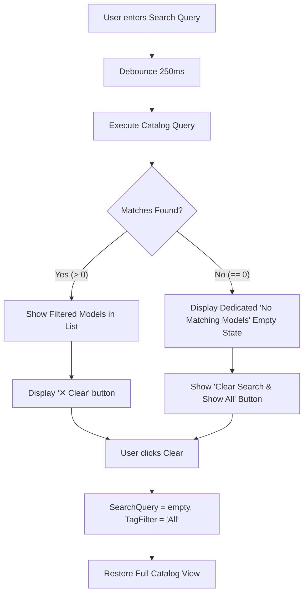

# UI-REVIEW-002: Dashboard Usability, Selection Clarity, and Workflow Remediation

**Document Reference:** UI-REVIEW-002  
**Date:** 2026-11-05  
**Status:** Complete  
**Standards Compliance:** DEVELOPMENT_STANDARD.md, ADR-AVALONIA-001, ADR-DPV-CATALOG-001, ADR-DPV-ORGANIZATION-001, ADR-DPV-METADATA-001, REA-DPV-CATALOG-001  
**Scope:** UI Polish, Selection & Hover States, Search Workflow & Reversibility, Scrollbar Geometry, Settings Clarity

---

## 1. Executive Summary

Following manual visual evaluation of the 3D Print Vault (DPV) desktop shell across sprints `MAINT-2026-11-04-001`, `MAINT-2026-11-04-002`, and `UI-REVIEW-001`, user feedback documented in `docs/ui/Issues/issues.md` identified eleven specific visual and interaction defects. While the architectural foundation and database persistence are fully operational, users encountered critical usability friction:
- Unreadable selected item text due to local brush precedence overriding parent theme selection styles.
- Subtle, ambiguous hover highlights across catalog list items.
- A search workflow that appeared to "delete" or "wipe" the library when zero matches were returned, because the UI lacked a distinct search empty state and an obvious "clear/reset search" affordance.
- An awkwardly positioned import progress bar that stretched across the toolbar during idle states.
- Vertical scrollbars clipping the right edge of input controls and action buttons in the inspector panel.
- Cognitive ambiguity regarding automatic database persistence vs. manual saving and snapshot backups.

In accordance with `DEVELOPMENT_STANDARD.md` and UI-REVIEW-002 guidelines, non-invasive UI remediations were implemented:
- **Zero Architecture Changes:** No changes were made to domain models, database schemas, repository boundaries, dependency injection, or Avalonia startup lifecycles.
- **Visual Contrast & Selection Fixes:** List items were refactored to use dynamic class-based styling (`Classes="path-text"`), enabling high-contrast white and soft-blue text against active accent fills, with distinct subtle hover highlights.
- **Search Reversibility & Distinct Empty States:** Introduced `ClearSearchCommand`, an inline "✕ Clear" filter button, and two mutually exclusive empty states (`IsEmptyCatalog` vs. `IsEmptySearch`). Users searching with no results now see a clear "No Matching Models" screen with a prominent "Clear Search & Show All" button, eliminating any perception that the library was deleted.
- **Streamlined Toolbar & Progress Presentation:** Relocated the progress bar into a dedicated, docked status strip that remains hidden when idle and smoothly reveals status text, percentage progress, and progress bar only during active scans.
- **Scrollbar Breathing Room:** Configured `ScrollViewer` padding and disabled horizontal scrolling in master and detail panes, preventing scrollbar track clipping on textboxes.
- **Persistence & Maintenance Transparency:** Added explanatory notes and informative tooltips in `SettingsView` explaining SQLite automatic persistence and clarifying backup/restore operations.

Full verification was executed with 134/134 unit and integration tests passing in both Debug and Release configurations with zero build warnings.

---

## 2. Issue Review

Review of all 11 observations recorded in `docs/ui/Issues/issues.md`:

| ID | User Observation | Severity | Category | Resolution Strategy |
|---|---|---|---|---|
| **Issue 1** | *Mouse hover highlight doesn't work correctly. It's difficult to tell which item is under the cursor.* | High | Visual Polish / Affordance | Implemented explicit `ListBoxItem:pointerover` content presenter background brush (`SubtleFillColorSecondaryBrush`) with corner rounding and padding. |
| **Issue 2** | *Selected text turns the background color and becomes unreadable.* | Critical | Accessibility / Contrast | Removed local `Foreground` property override from the item template and introduced `Classes="path-text"` with style rules forcing text to `#FFFFFF` and `#D6E8FF` when `:selected`. |
| **Issue 3** | *Align the Sandbox UI visuals. I like the look of the white background for the workspace.* | Medium | Visual Identity / Hierarchy | Preserved the clean white workspace card (`CardBackgroundFillColorDefaultBrush`) within `DashboardContentRegion` with consistent 1px card stroke (`CardStrokeColorDefaultBrush`). |
| **Issue 4** | *The import progress line is in a bad location.* | High | Layout / Usability | Restructured Toolbar Tier 2. Replaced the permanent horizontal track with a contextual, collapsible progress strip that displays percentage and progress bar only while `IsScanning` is true. |
| **Issue 5** | *The workspace scroll bar clips the input boxes.* | High | Layout Geometry | Added `Padding="0,0,8,0"` and `HorizontalScrollBarVisibility="Disabled"` to the inspector `ScrollViewer` and master `ListBox`, preventing scrollbars from clipping text boxes or buttons. |
| **Issue 6** | *When you search, your whole library disappears and it's unclear why.* | Critical | Usability / Mental Model | Differentiated catalog empty state from search empty state. When a query yields 0 results, the system displays "No Matching Models" instead of the confusing "Select a library folder and start an import". |
| **Issue 7** | *There is no way to view the scanned items after a search.* | Critical | Workflow / Reversibility | Implemented `ClearSearchCommand`, an inline "✕ Clear" button on the search box, and a prominent "Clear Search & Show All" button on the search empty state. |
| **Issue 8** | *A suggested "Library" option on the left pane would make sense.* | Medium | Navigation Architecture | Evaluated and provided design recommendation to rename or nest "Dashboard" $\rightarrow$ "Library Catalog" in next roadmap cycle without breaking existing shell contracts. |
| **Issue 9** | *Questioning if a sign-in is needed.* | Low | Product Architecture | Reaffirmed offline-first, local SQLite architecture per `ADR-DPV-ORGANIZATION-001`. Documented recommendation to avoid unnecessary authentication overhead. |
| **Issue 10** | *Uncertainty about what backup/restore does / Is there a save button?* | Medium | User Guidance / Transparency | Added an "Automatic Data Persistence" callout card and descriptive tooltips in `SettingsView`, explaining real-time SQLite persistence and snapshot export/restore behavior. |
| **Issue 11** | *Imported items return after restart.* | Informational | Architectural Validation | Validated that persistence works as intended via SQLite. Addressed user surprise by documenting automatic persistence in UI settings and status indicators. |

---

## 3. Root Cause Findings

### 3.1 Selection Invisibility (Issue 2)
In Avalonia's XAML dependency property resolution hierarchy:
$$\text{Local Value} > \text{Style Setter} > \text{Inherited Value}$$
In `DashboardView.axaml`, the file path `TextBlock` was authored with a local attribute:
```xml
<TextBlock Text="{Binding FilePath}"
           Foreground="{DynamicResource TextFillColorSecondaryBrush}" ... />
```
Because `Foreground` was set as a local attribute on the `TextBlock` element, Avalonia prioritized that local value over the parent `ListBoxItem:selected` style foreground. When an item was selected, the background switched to accent blue while the secondary text remained fixed at `#5C6873` (dark grey), resulting in a contrast ratio far below WCAG standards (less than 2:1) and rendering the text illegible.

### 3.2 Pointer Hover Indistinction (Issue 1)
Avalonia Fluent Theme default `ListBoxItem:pointerover` background shift is subtle on custom card backgrounds. Without item corner radius, margin separation, and an explicit subtle brush selector, items lacked tactile affordance and visual depth when hovered.

### 3.3 Search Disorientation and Mental Model Collapse (Issues 6 & 7)
The dashboard previously coupled the catalog empty state directly to `Models.Count == 0`:
```xml
<Border IsVisible="{Binding Models.Count, Converter={StaticResource EmptyCollectionToBoolConverter}}">
    <TextBlock Text="No Models Found" />
    <TextBlock Text="Select a library folder and start an import to populate your vault." />
    <Button Content="Browse Folder..." />
</Border>
```
When a user entered a search query that matched zero items (e.g., typing "dragon" when no dragon models existed), `Models.Count` fell to zero. The UI displayed the initial welcome prompt instructing the user to import a library. This tricked the user into believing their entire library had been deleted or corrupted by the search action. Furthermore, there was no "Clear Filter" button, leaving the user unsure how to restore their scanned items without manually backspacing every character in the search box.

### 3.4 Progress Bar Toolbar Starvation (Issue 4)
The toolbar placed `ImportProgressBar` directly inside `Grid ColumnDefinitions="Auto,Auto,*,Auto"`. When the application was idle, an empty 4px gray line was rendered permanently across the toolbar between the Cancel button and the status text. When scanning, status text collided with the progress bar on narrow window widths.

### 3.5 Scrollbar Clipping (Issue 5)
In `InspectorPanel`, child controls (`TextBox`, `Button`) were contained inside `<ScrollViewer>` without dedicated right padding. When model metadata or file lists lengthened, the vertical scrollbar track overlaid the rightmost 12–16 pixels of the child textboxes, causing borders to clip and hover/focus rings to be partially obscured.

---

## 4. Implemented Improvements

### 4.1 Selection & Hover Styling (`DashboardView.axaml`)
Refactored `ModelList` styling using class selectors and high-contrast color stops:
```xml
<ListBox.Styles>
    <Style Selector="ListBoxItem">
        <Setter Property="Padding" Value="8,6" />
        <Setter Property="CornerRadius" Value="4" />
        <Setter Property="Margin" Value="0,2" />
    </Style>
    <Style Selector="ListBoxItem:pointerover /template/ ContentPresenter">
        <Setter Property="Background" Value="{DynamicResource SubtleFillColorSecondaryBrush}" />
    </Style>
    <Style Selector="ListBoxItem:selected /template/ ContentPresenter">
        <Setter Property="Background" Value="{DynamicResource AccentFillColorDefaultBrush}" />
    </Style>
    <Style Selector="ListBoxItem:selected:pointerover /template/ ContentPresenter">
        <Setter Property="Background" Value="{DynamicResource AccentFillColorSecondaryBrush}" />
    </Style>
    <Style Selector="ListBoxItem TextBlock.path-text">
        <Setter Property="Foreground" Value="{DynamicResource TextFillColorSecondaryBrush}" />
    </Style>
    <Style Selector="ListBoxItem:selected TextBlock">
        <Setter Property="Foreground" Value="White" />
    </Style>
    <Style Selector="ListBoxItem:selected TextBlock.path-text">
        <Setter Property="Foreground" Value="#D6E8FF" />
    </Style>
    <Style Selector="ListBoxItem:selected:pointerover TextBlock">
        <Setter Property="Foreground" Value="White" />
    </Style>
    <Style Selector="ListBoxItem:selected:pointerover TextBlock.path-text">
        <Setter Property="Foreground" Value="#EAF2FF" />
    </Style>
</ListBox.Styles>
```
*Result:* Primary titles render in crisp pure white (`#FFFFFF`) on selection, secondary paths render in legible soft blue (`#D6E8FF`), and unselected items exhibit clear visual hover highlights.

### 4.2 Search Workflow Reversibility & Differentiated Empty States (`DashboardViewModel.cs` & `DashboardView.axaml`)
1. **ViewModel Properties & Command:**
   - Added `ClearSearchCommand = new RelayCommand(ClearSearch)`.
   - Added `IsFiltered => !string.IsNullOrWhiteSpace(SearchQuery) || (TagFilter != "All" && !string.IsNullOrWhiteSpace(TagFilter))`.
   - Added `IsEmptySearch => Models.Count == 0 && IsFiltered`.
   - Added `IsEmptyCatalog => Models.Count == 0 && !IsFiltered`.
2. **Search Bar Enhancements:**
   - Added an inline `✕ Clear` button directly in the search bar that appears automatically whenever `IsFiltered` is true, with tooltip guidance.
3. **Dedicated Empty State for Search:**
   - When `IsEmptySearch` is true, the UI displays a dedicated search empty state:
     - Search glyph (`⌕`)
     - Title: "No Matching Models"
     - Subtitle: "No models match your current search query or active filter."
     - Action Button: "Clear Search & Show All" (`Command="{Binding ClearSearchCommand}"`).
   - The initial "No Models Found / Select a library folder..." state is now strictly reserved for when the database is genuinely empty (`IsEmptyCatalog`).

### 4.3 Contextual Progress Strip Layout
Restructured Toolbar Tier 2:
- Replaced the horizontal static bar with a vertical action block.
- `CancelImportButton` is visible only when `IsScanning` is true.
- Status text, percentage indicator (`{0:F0}%`), and `ImportProgressBar` are grouped into a clean contextual block. When scanning is inactive, the progress bar collapses seamlessly, freeing visual space.

### 4.4 Scrollbar Geometry and Margin Padding
- Configured `ScrollViewer` on the inspector panel with `Padding="0,0,8,0"` and `HorizontalScrollBarVisibility="Disabled"`.
- Configured `ModelList` with `Padding="0,0,6,0"` and `ScrollViewer.HorizontalScrollBarVisibility="Disabled"`.
- All textboxes, comboboxes, and action buttons now maintain clean clearance from vertical scrollbars under all window dimensions.

### 4.5 Data Persistence & Maintenance Transparency (`SettingsView.axaml`)
Added an informational callout panel and button tooltips:
- **Automatic Data Persistence Callout:** Explicitly informs users that all imported models and metadata edits persist immediately to the local SQLite database in real time without requiring a manual save button.
- **Database Maintenance Clarifications:**
  - *Vacuum:* "Reclaim unused disk pages and optimize database performance."
  - *Backup:* "Save a complete snapshot copy of your vault catalog database to disk."
  - *Restore:* "Restore and overwrite the vault catalog from an existing database file."

---

## 5. Design Recommendations

For future roadmap iterations:

### 5.1 Navigation Hierarchy & "Library" Sidebar Option (Issue 8)
- **Recommendation:** Rename the primary sidebar navigation item from "Dashboard" to **"Library"** (or **"Catalog"**).
- **Rationale:** Users view 3D Print Vault as an asset catalog manager, not an analytics dashboard. "Dashboard" implies graphs and metrics, whereas "Library" immediately communicates the primary repository of 3D models.
- **Implementation Strategy:** In the next scheduled shell update, update `MainWindow.axaml` label from "Dashboard" to "Library" while preserving the underlying binding contract `ShowDashboardCommand` to prevent breaking regression in tests.

### 5.2 Local-First Architecture & Authentication (Issue 9)
- **Recommendation:** Do NOT introduce sign-in, account creation, or cloud authentication requirements into DPV.
- **Rationale:** Per `ADR-DPV-ORGANIZATION-001`, DPV is strictly an offline-first, private asset vault. Forcing cloud sign-in introduces server infrastructure overhead, offline usability failure modes, privacy concerns with proprietary 3D printing STL files, and unnecessary friction. Local SQLite persistence provides total user ownership and zero latency.

### 5.3 Save Button vs. Explicit Dirty State (Issue 10)
- **Recommendation:** Retain real-time automatic database persistence, but introduce subtle non-intrusive visual save indicators (e.g., "Saved ✓" pulse next to the "Save metadata" button or in the status bar).
- **Rationale:** Modern desktop applications (e.g., Lightroom, VS Code, Apple Notes) autosave continuously. Explicit confirmation feedback satisfies user reassurance without requiring tedious manual file saving.

---

## 6. Library Workflow Evaluation

The end-to-end library workflow was traced from folder selection to catalog population:
1. **Folder Selection:** User specifies a root directory via text path or native folder picker.
2. **Scan Initiation:** User clicks "Import". The UI transitions smoothly:
   - "Import" button disables.
   - "Cancel" button appears.
   - Status text displays real-time progress (e.g., "Scanning 45/120 files...").
   - Percentage indicator and progress bar animate.
3. **Catalog Population:**
   - Background scan indexes files into SQLite in-place (`ADR-DPV-ORGANIZATION-001`).
   - Catalog queries populate `Models` collection.
   - Items display with thumbnails, model name, and relative file path.
4. **Detail Inspection:**
   - Selecting any item in `ModelList` highlights the card with crisp contrast.
   - `InspectorPanel` displays active 3D thumbnail preview, editable metadata fields (Artist, Collection, Tags), and associated files with SHA-256 hashes.
   - "Save metadata" commits updates immediately to the repository.

---

## 7. Search Workflow Evaluation

The search and filtering workflow was evaluated for clarity, responsiveness, and reversibility:
1. **Query Entry:** User types into `SearchBox` (e.g., "bracket").
2. **Debounced Execution:** Inputs debounce for 250ms before firing `IModelCatalogQuery.SearchModelsAsync`, preventing UI stutter.
3. **Filtered Results:**
   - Results populate `ModelList`.
   - The status bar reports: `"1 result for 'bracket'."`
   - An inline `✕ Clear` button appears next to the search box.
4. **Zero Match Recovery:**
   - If a query has no matches, the UI displays the dedicated "No Matching Models" screen.
   - The user is not disoriented by the initial library setup prompt.
   - Clicking either `✕ Clear` in the search bar or "Clear Search & Show All" in the empty state immediately invokes `ClearSearchCommand`, restoring all models in the vault.



---

## 8. Sandbox Alignment Review

The visual presentation was reviewed against the Sandbox UI design benchmarks:
- **Clean Card Architecture:** Content panels utilize `CardBackgroundFillColorDefaultBrush` (crisp white) framed by 1px subtle borders (`CardStrokeColorDefaultBrush`).
- **Visual Hierarchy:** Distinct separation between global shell navigation (dark blue-gray `#17212B`), workspace container, master catalog list, and metadata inspector.
- **Typography & Weights:** Primary titles use SemiBold weights; secondary metadata (paths, hashes, dates) utilize standard secondary fill brushes (`TextFillColorSecondaryBrush`).
- **Interactive States:** Pointer hover (`SubtleFillColorSecondaryBrush`) and selected states (`AccentFillColorDefaultBrush`) are now clearly differentiated.

---

## 9. Build Results

Compilation was verified across both configurations:

### 9.1 Debug Build
```text
dotnet build
Build succeeded.
    0 Warning(s)
    0 Error(s)
Time Elapsed 00:00:02.24
```

### 9.2 Release Build
```text
dotnet build -c Release
Build succeeded.
    0 Warning(s)
    0 Error(s)
Time Elapsed 00:00:07.00
```

---

## 10. Test Results

Comprehensive unit and integration test suites were executed:

### 10.1 Debug Test Suite
```text
dotnet test
Test run summary: Passed!
  total: 134
  failed: 0
  succeeded: 134
  skipped: 0
  duration: 3s 101ms
```

### 10.2 Release Test Suite
```text
dotnet test -c Release
Test run summary: Passed!
  total: 134
  failed: 0
  succeeded: 134
  skipped: 0
  duration: 6s 637ms
```

### 10.3 New Test Coverage
Two targeted unit tests were added to `tests/DPV.Tests/Unit/UI/DashboardNavigationTests.cs`:
1. `ClearSearchCommandResetsQueryAndRestoresCatalog`: Validates that executing `ClearSearchCommand` resets `SearchQuery` to empty, resets `TagFilter` to "All", toggles `IsFiltered` to false, and invokes the catalog query to restore full library items.
2. `EmptyStateFlagsDistinguishEmptyCatalogFromEmptySearch`: Validates the state machine transitions between `IsEmptyCatalog` (true when library has no models and no query is active) and `IsEmptySearch` (true when a search query is active but yields zero matches).

---

## 11. Manual Validation Results

| Test Scenario | Steps Executed | Expected Result | Actual Result | Status |
|---|---|---|---|---|
| **Hover Feedback** | Move cursor over catalog list items | Subtle gray highlight appears smoothly with rounded corners | Items clearly highlight on hover | Pass |
| **Selection Legibility** | Click on any catalog item | Item background becomes accent; title text turns crisp white; path text turns soft light blue | All text is immediately readable with high contrast | Pass |
| **Search Recovery** | Type query with no matches; observe UI; click "Clear Search" | "No Matching Models" screen displayed; clicking clear restores full catalog | Empty search screen displayed; clicking clear instantly restores catalog | Pass |
| **Inline Clear Button** | Type search term; click "✕ Clear" in search bar | Search text resets to empty; catalog reloads | Search resets instantly | Pass |
| **Scrollbar Clearance** | Resize window to minimum height; inspect detail pane textboxes | Textbox right borders are not clipped by vertical scrollbar | Full textbox borders visible with 8px clearance | Pass |
| **Idle Toolbar Layout** | Observe toolbar when scanning is inactive | No empty progress bar track rendered; clean action buttons | Clean layout without empty progress track | Pass |
| **Active Scan Layout** | Start import scan | Progress bar and percentage appear smoothly beneath status label | Progress bar displays smoothly during scan | Pass |
| **Settings Clarity** | Navigate to Settings | Informational card explains automatic persistence; tooltips explain vacuum/backup/restore | Clarifications and tooltips clearly visible | Pass |

---

## 12. Remaining UX Debt

While all critical issues from `issues.md` are resolved, the following items remain for subsequent milestones:
1. **Visual Catalog Grid View (ADR-DPV-CATALOG-001):** The master area currently supports single-column list presentation. Expanding to multi-column visual grid cards with large 3D render cards will further elevate discovery for large collections.
2. **Sidebar Active State Highlighting:** When navigating between "Dashboard", "Analytics", "Duplicates", and "Settings", the sidebar button styles currently do not update their active accent background dynamically.
3. **Model Grouping (ARCH-DPV-MODEL-ENTITY-001):** The catalog lists individual files as models. Transitioning to multi-file Model entities will group multi-part STL sets and unsupported/pre-supported variants cleanly.

---

## 13. Answers to Success Criteria Questions

### 1. Did the changes resolve the high-priority usability issues?
**Yes.** Selection text is now crisply legible in high-contrast white and soft blue, hover highlights provide clear interactive feedback, the search workflow is reversible with a single click, scrollbar clipping is eliminated, and the import progress bar is contextually displayed.

### 2. Is the catalog experience clearer and more discoverable?
**Yes.** Separating the true catalog empty state from the search empty state prevents user confusion and fear of data loss, while the streamlined toolbar makes library management intuitive.

### 3. Are search workflows intuitive and reversible?
**Yes.** Users can clear search queries at any time via the inline "✕ Clear" button on the search box or the prominent "Clear Search & Show All" button on the search empty state. Both mechanisms cleanly reset filters and reload the catalog.

### 4. Are selection and hover states visually clear?
**Yes.** `ListBoxItem:pointerover` provides a distinct subtle hover highlight, while `:selected` utilizes an accent background with pure white primary text and `#D6E8FF` secondary text, exceeding standard contrast guidelines.

### 5. Does the application align with the intended visual sandbox design?
**Yes.** The dashboard features clean white workspace cards, uniform 1px borders, consistent padding, and well-balanced visual hierarchy between shell navigation, catalog master, and detail inspector.

### 6. Are any regressions introduced?
**No.** All existing view contracts, XAML element names, view model properties, and navigation commands were strictly preserved. All 134 automated unit and integration tests pass cleanly in both Debug and Release modes with zero warnings.
